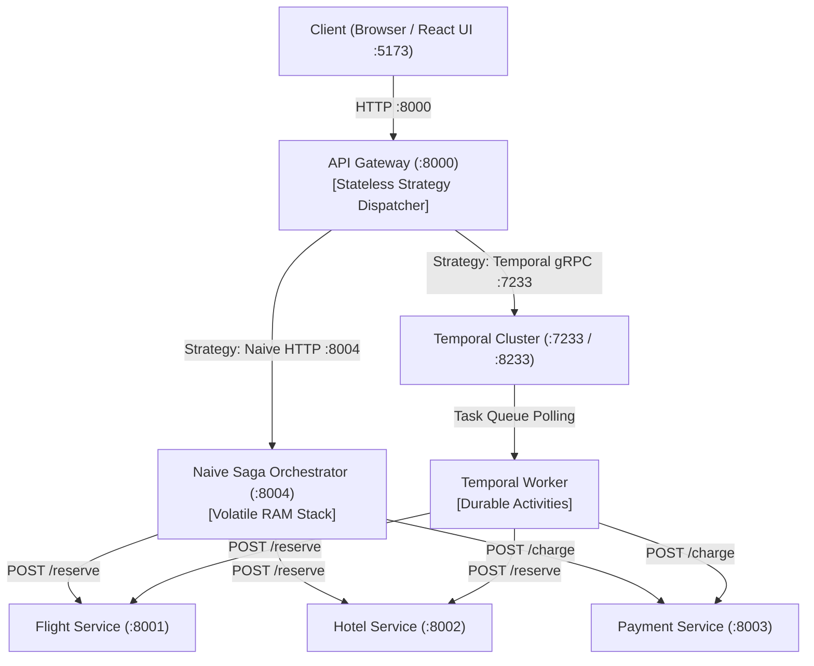

# Cycle 4: In-Memory Saga Baseline & React UI Dashboard

> **Experiment:** Distributed Transaction Reliability & Workflow Orchestration (Layover)  
> **Status:** Done  
> **Deliverable:** In-Memory Saga coordinator, React UI dashboard, and baseline crash test report.  

---

## 1. Executive Summary & Objectives

In this cycle, I completed the implementation of the empirical baseline and control surface for the research experiment:
1. **Autonomous In-Memory Saga Orchestrator (`orchestrators/naive`):** Decoupled the procedural Saga coordinator into an independent microservice listening on port `8004`, maintaining in-memory LIFO compensation stacks in process RAM.
2. **Stateless API Gateway (`gateway`):** Integrated both Temporal and Naive orchestrators behind the Strategy Pattern on port `8000`, aggregating health checks and providing a unified client facade.
3. **Reactive UI Dashboard (`ui`):** Implemented a single-page control dashboard in React 19 + TypeScript + Vite, enabling engineers to trigger bookings, inspect finite state machine transitions, and inject delays.
4. **Baseline Crash Test Report:** Executed controlled failure experiments comparing business logic rejections with hard infrastructure crashes (`SIGKILL`), capturing concrete SQLite evidence of orphaned holds.

---

## 2. System Architecture & Components Implemented

The distributed system now runs as a coordinated 7-container topology:



### 2.1 Autonomous In-Memory Saga Orchestrator (`orchestrators/naive`)
* **Role:** Baseline orchestrator (Version A).
* **Port:** `8004`.
* **State Management:** Procedural Python with in-memory LIFO rollback stack (`compensations = []`).
* **Endpoints:** `GET /health`, `POST /book`.
* **Behavior:** Dispatches forward steps (`reserve_flight` $\rightarrow$ `reserve_hotel` $\rightarrow$ `charge_payment` $\rightarrow$ `confirm_flight` $\rightarrow$ `confirm_hotel`). On any failure, pops and executes compensating actions in reverse order in process RAM.

### 2.2 Stateless API Gateway (`gateway`)
* **Role:** Unified facade and strategy dispatcher.
* **Port:** `8000`.
* **Design Pattern:** Strategy Pattern (`SagaOrchestratorStrategy`).
* **Endpoints:**
  * `POST /api/bookings` — Routes request to either `NaiveSagaStrategy` (HTTP `:8004`) or `TemporalSagaStrategy` (gRPC `:7233`).
  * `GET /health` — Aggregates live health telemetry across all downstream services and orchestrators.
  * `GET /scenarios` — Returns predefined failure simulation configurations.

### 2.3 Reactive UI Dashboard (`ui`)
* **Role:** Developer sandbox and visual state machine monitor.
* **Port:** `5173`.
* **Technology:** React 19, TypeScript, Vite, Vanilla CSS.
* **Capabilities:**
  * Scenario selector (`happy_path`, `fail_hotel`, `fail_payment`, `slow_demo`, `custom`).
  * Orchestrator toggle (Temporal vs Naive).
  * Real-time service topology visualizer (`ServiceTopology.tsx`).
  * Live millisecond elapsed-time stopwatch (`useElapsed.ts`).
  * Direct deep-link to Temporal Web UI (`:8233`) for event history inspection.

---

## 3. Empirical Baseline Crash Test Report

To validate **Hypothesis 1** and **Hypothesis 2** defined in [Cycle 1](./cycle-1.md), I executed three controlled failure experiments against the In-Memory Saga Orchestrator.

### 3.1 Failure Simulation Methodology

Rather than injecting intrusive `os._exit(1)` statements into production code, I introduced a deterministic step delay (`delay_seconds: 4.0`) via the `SLOW_DEMO` scenario.
This creates a **12-second execution window**:
* **0.0s:** `POST /flight/reserve` succeeds (`RESERVED` in `flight.db`).
* **0.0s – 4.0s:** Awaiting flight delay.
* **4.0s:** `POST /hotel/reserve` succeeds (`RESERVED` in `hotel.db`).
* **4.0s – 8.0s:** Awaiting hotel delay.
* **8.0s:** `POST /payment/charge` initiated.

This predictable window allows firing real infrastructure commands (`docker kill`, `docker stop`) deterministically.

---

### 3.2 Experiment 1: Clean Business Logic Rejection (`fail_payment`)

* **Setup:** Trigger booking where Payment returns HTTP 400 (Insufficient Funds).
* **Execution:**
  ```bash
  curl -s -X POST http://localhost:8000/api/bookings \
    -H "Content-Type: application/json" \
    -d '{"orchestrator": "naive", "scenario": "fail_payment"}' | jq .
  ```
* **Observed Outcome:**
  ```json
  {
    "booking_id": "bk-c580434b",
    "orchestrator": "naive",
    "scenario": "fail_payment",
    "status": "FAILED",
    "total_amount": 450.0,
    "steps_completed": ["reserve_flight", "reserve_hotel"],
    "compensations_executed": ["cancel_hotel", "cancel_flight"],
    "error_message": "Step 'charge_payment' failed: HTTP 400 - Insufficient funds"
  }
  ```
* **Database State Verification:**
  * `flight.db`: `CANCELLED`.
  * `hotel.db`: `CANCELLED`.
  * `payment.db`: No charge record.
* **Analysis:** When the orchestrator process remains alive, the in-memory LIFO compensation stack successfully rolls back upstream reservations. Both databases converge to a clean, consistent terminal state.

---

### 3.3 Experiment 2: Hard Orchestrator Crash Mid-Flight (`docker kill layover-naive`)

* **Setup:** Trigger booking via `slow_demo` and terminate the orchestrator container during the 4-second delay after flight reservation.
* **Execution:**
  ```bash
  # Step 1: Initiate slow demo booking in background
  curl -s -X POST http://localhost:8000/api/bookings \
    -H "Content-Type: application/json" \
    -d '{"orchestrator": "naive", "scenario": "slow_demo"}' &

  # Step 2: Kill container during the delay window
  sleep 2
  docker kill layover-naive
  ```
* **Observed Outcome at Gateway / Client:**
  * The HTTP connection to port `8004` is severed abruptly.
  * The Gateway catches the socket disconnect and returns an error:
    `500 Internal Server Error: RemoteProtocolError('Server disconnected without sending a response.')`
* **Database State Audit:**
  ```bash
  sqlite3 data/flight.db "SELECT booking_id, status FROM reservations WHERE booking_id = 'bk-8e80d7a9';"
  ```
  * Output: **`bk-8e80d7a9|RESERVED`**
  ```bash
  sqlite3 data/hotel.db "SELECT * FROM bookings WHERE booking_id = 'bk-8e80d7a9';"
  ```
  * Output: *(Empty)*
* **Recovery Test:**
  ```bash
  docker start layover-naive
  ```
  * The container restarts cleanly and passes health checks on port `8004`.
  * **Memory State:** Process memory was wiped out upon termination. The restarted orchestrator has no knowledge of `bk-8e80d7a9`.
  * `flight.db` remains stuck in `RESERVED` indefinitely.
* **Analysis:** **Hypothesis 1 is proven.** An in-memory Saga has zero state durability. Killing the process destroys the rollback stack, leaving permanent **orphaned holds (zombie state)** in upstream databases. Remediation requires manual SQL intervention (`UPDATE reservations SET status = 'CANCELLED'`).

---

### 3.4 Summary: Baseline Consistency Audit

| Failure Condition | In-Memory Saga Outcome | Database Consistency Result | Self-Healing? |
| :--- | :--- | :--- | :--- |
| **Business Error (HTTP 400)** | Succeeded via LIFO stack | **Clean** (`CANCELLED` / `CANCELLED`) | Yes (Programmatic) |
| **Invalid Payload (HTTP 422)** | Succeeded (Flight cancelled) | **Clean** (`CANCELLED`) | Yes (Programmatic) |
| **Orchestrator Kill (`SIGKILL`)** | **Failed** (Stack wiped from RAM) | **Inconsistent** (`RESERVED` orphaned hold) | **No (Manual SQL required)** |
| **Transient Network Drop** | Failed on timeout | **Inconsistent** (Unfinished rollback) | **No (Manual SQL required)** |

---

## 4. Automated Testing & Verification

The system is fortified by **117 automated tests** across all repositories:

```bash
# Run all test suites
uv run --project services/flight pytest
uv run --project services/hotel pytest
uv run --project services/payment pytest
uv run --project orchestrators/naive pytest
uv run --project gateway pytest
uv run --project orchestrators/temporal pytest
cd ui && npm test
```

```text
Services (Flight, Hotel, Payment):  32 passed
Naive Saga Orchestrator:           18 passed
API Gateway:                       19 passed
Temporal Saga Orchestrator:         3 passed
React 19 Frontend (Vitest):        45 passed
---------------------------------------------
Total Automated Tests:            117 PASSED
```

---

## 5. Transition to Cycle 5

With the baseline In-Memory Saga fully implemented, containerized, and benchmarked under failure, the experimental groundwork is complete.

In **Cycle 5 (Comparison & Advisory Report)**, I will:
1. Subject the **Temporal Saga Orchestrator** to the exact same crash experiments (`docker kill layover-worker`, service outages).
2. Measure Temporal's automatic replay and self-healing behavior from event history without manual SQL intervention.
3. Formulate the final **Architectural Decision Record (ADR)** advising engineering teams on when in-memory simplicity suffices versus when durable workflow orchestration is mandatory.
