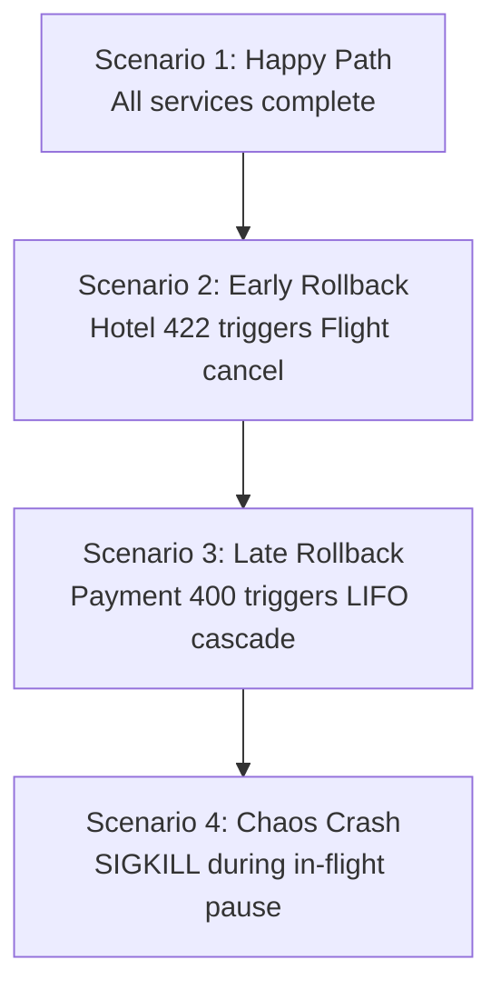

# Layover: Live Demo Runbook & Defense Scenarios

> **Project:** Distributed Travel Booking System (Layover)  
> **Focus:** Fault Tolerance & Workflow Reliability Under Partial Failure  
> **Target Audience:** Technical Examiners, Software Architects, Academic Jury  
> **Evaluation Framework:** Bloom’s Taxonomy — Level 4 (*Analysis*) & Level 5 (*Evaluation*)

---

## 1. System Pre-Flight Checklist

Before launching the presentation, verify that all 7 application services, 2 monitoring containers, and the frontend dev server are healthy and accessible.

### 1.1 Running Container Topology

```bash
docker compose ps
```

*Expected Status:* All containers should report `healthy` or `running`:
* `layover-flight` (`:8001`)
* `layover-hotel` (`:8002`)
* `layover-payment` (`:8003`)
* `layover-naive` (`:8004`)
* `temporal` (`:7233` gRPC / `:8233` Web UI)
* `layover-worker` (`:8005` metrics)
* `layover-gateway` (`:8000`)
* `layover-prometheus` (`:9090`)
* `layover-grafana` (`:3000`)

### 1.2 Access URLs

* **React UI Dashboard:** [`http://localhost:5173`](http://localhost:5173)
* **API Gateway Health:** [`http://localhost:8000/health`](http://localhost:8000/health)
* **Temporal Web UI:** [`http://localhost:8233/namespaces/layover/workflows`](http://localhost:8233/namespaces/layover/workflows)
* **Grafana Dashboard:** [`http://localhost:3000`](http://localhost:3000) *(anonymous admin access, pre-configured Layover dashboard)*
* **Prometheus Metrics:** [`http://localhost:9090`](http://localhost:9090)

### 1.3 Managing Test Account Balance (`user_1`)

The account balance for demo customer `user_1` governs whether payment succeeds or declines:

```bash
# 1. Check current balance:
curl -s http://localhost:8003/account/user_1

# 2. Reset balance to $1,000 (Ideal for demonstration: permits Happy Path ($400) but triggers 400 Insufficient Funds on Payment Decline ($2,500)):
docker exec layover-payment python3 -c "import sqlite3; con = sqlite3.connect('/app/data/payment.db'); con.execute(\"UPDATE accounts SET balance = 1000.0 WHERE customer_id = 'user_1'\"); con.commit()"

# 3. Give user large funds ($10,000) for continuous Happy Path load testing:
docker exec layover-payment python3 -c "import sqlite3; con = sqlite3.connect('/app/data/payment.db'); con.execute(\"UPDATE accounts SET balance = 10000.0 WHERE customer_id = 'user_1'\"); con.commit()"
```

---

## 2. Interactive Demo Scenarios



---

### Scenario 1: Happy Path (Baseline Transactional Success)

* **Objective:** Demonstrate regular, error-free distributed transaction execution across all three independent microservices.
* **Orchestrator:** `In-memory (baseline)` or `Temporal (durable)`
* **UI Action:**
  1. Open [`http://localhost:5173`](http://localhost:5173).
  2. Select scenario **Happy path** (Flight LH-204 `$250` + Grand Palace Hotel `$150` = Total `$400`).
  3. Click **Confirm & Pay ($400.00)**.
* **Observed UI Behavior:**
  * Animated light pulses travel smoothly forward: Flight $\rightarrow$ Hotel $\rightarrow$ Payment.
  * Node status badges settle at:
    * Flight: `CONFIRMED` (`ok`)
    * Hotel: `CONFIRMED` (`ok`)
    * Payment: `CHARGED` (`ok`)
  * Execution Summary displays 5 forward steps:
    1. `reserve_flight`
    2. `reserve_hotel`
    3. `charge_payment`
    4. `confirm_flight`
    5. `confirm_hotel`
* **Under-the-Hood Database Verification (Terminal):**
  ```bash
  # Check Flight DB:
  docker exec layover-flight python3 -c "import sqlite3; con = sqlite3.connect('/app/data/flight.db'); print(con.execute('SELECT booking_id, status FROM flight_bookings ORDER BY id DESC LIMIT 1').fetchall())"

  # Check Hotel DB:
  docker exec layover-hotel python3 -c "import sqlite3; con = sqlite3.connect('/app/data/hotel.db'); print(con.execute('SELECT booking_id, status FROM hotel_bookings ORDER BY id DESC LIMIT 1').fetchall())"

  # Check Payment DB:
  docker exec layover-payment python3 -c "import sqlite3; con = sqlite3.connect('/app/data/payment.db'); print(con.execute('SELECT booking_id, amount, status FROM payments ORDER BY id DESC LIMIT 1').fetchall())"
  ```
* **Academic Commentary (Bloom Level 4 — Analysis):**
  > *«Under zero-loss network conditions and valid inputs, both architectures achieve identical consistency. However, in the In-Memory orchestrator, the state machine is ephemeral, living only in process memory without any persistence.»*

---

### Scenario 2: Hotel Rejection (Early Upstream Compensation)

* **Objective:** Demonstrate partial failure rollback where an early step succeeds, but a downstream step fails immediately, triggering a single compensating action.
* **Orchestrator:** `In-memory (baseline)`
* **UI Action:**
  1. Select scenario **Hotel rejection** (Total `$299`, Hotel `INVALID_HOTEL_OVERBOOKED`, price `-1.0`).
  2. Click **Confirm & Pay**.
* **Observed UI Behavior:**
  * Flight is initially reserved (`RESERVED`).
  * Hotel returns `HTTP 422 Unprocessable Entity` (flashes red `err`).
  * Payment is bypassed (`SKIPPED`, not attempted).
  * Flight connection reverses (red reverse light pulse), and Flight transitions to `unwinding` $\rightarrow$ `CANCELLED`.
  * Outcome Card shows **Booking rolled back** (`COMPENSATED`).
  * Execution Summary:
    * Completed: `reserve_flight`
    * Compensations: `cancel_flight`
* **Database Verification (Terminal):**
  ```bash
  docker exec layover-flight python3 -c "import sqlite3; con = sqlite3.connect('/app/data/flight.db'); print(con.execute('SELECT booking_id, status FROM flight_bookings ORDER BY id DESC LIMIT 1').fetchall())"
  # Output: [('bk-...', 'CANCELLED')]
  ```
* **Academic Commentary:**
  > *«This demonstrates the fundamental property of the Saga pattern: atomic rollback without distributed two-phase locking (2PC). The database lock was never held across microservice boundaries; instead, an explicit compensating transaction (`POST /cancel`) was dispatched.»*

---

### Scenario 3: Payment Decline (Multi-Service Cascading LIFO Rollback)

* **Objective:** Demonstrate end-of-workflow failure where multiple upstream reservations succeeded and must be rolled back in strict reverse order (Last-In, First-Out).
* **Setup Prerequisite:** Ensure balance is set to `$1,000.0` (using Section 1.3).
* **Orchestrator:** `In-memory (baseline)`
* **UI Action:**
  1. Select scenario **Payment decline** (Total `$2,500.00` > Account balance `$1,000.00`).
  2. Click **Confirm & Pay**.
* **Observed UI Behavior:**
  * Flight reserves (`RESERVED`), Hotel reserves (`RESERVED`).
  * Payment rejects with `HTTP 400 Insufficient funds` (turns red).
  * Rollback progresses in strict LIFO order:
    1. Hotel unwinds first $\rightarrow$ `CANCELLED` (room hold released).
    2. Flight unwinds second $\rightarrow$ `CANCELLED` (seat hold released).
  * Execution Summary clearly logs the LIFO sequence:
    * `Cancel hotel`
    * `Cancel flight`
* **Database Verification (Terminal):**
  ```bash
  docker exec layover-flight python3 -c "import sqlite3; con = sqlite3.connect('/app/data/flight.db'); print(con.execute('SELECT booking_id, status FROM flight_bookings ORDER BY id DESC LIMIT 1').fetchall())"
  docker exec layover-hotel python3 -c "import sqlite3; con = sqlite3.connect('/app/data/hotel.db'); print(con.execute('SELECT booking_id, status FROM hotel_bookings ORDER BY id DESC LIMIT 1').fetchall())"
  ```
* **Academic Commentary (Bloom Level 4 — Analysis):**
  > *«LIFO compensation ordering is critical in real-world systems to prevent deadlocks and ensure that dependencies established in forward steps are torn down symmetrically.»*

---

### Scenario 4: Chaos Crash & Process Failure (The Core Benchmark)

> [!IMPORTANT]
> This is the central experiment of the thesis that differentiates procedural in-memory execution from durable event-sourced orchestration.

#### Step 4A: The In-Memory Crash (Orphaned Holds Leak)

1. In UI, set engine to **`In-memory (baseline)`**.
2. Select scenario **Chaos pause (4s)** (adds a 4.0-second delay between Flight and Hotel).
3. Click **Confirm & Pay**.
4. While the UI displays *"Coordinating saga transaction..."* and Flight is reserved, **immediately execute `SIGKILL` on the naive orchestrator container in terminal**:
   ```bash
   docker kill layover-naive
   ```
5. **UI Outcome:** The browser request fails with a network/gateway error (502 Bad Gateway or connection timeout).
6. **The Critical Evidence (Terminal):**
   ```bash
   # Inspect the Flight database for the last booking:
   docker exec layover-flight python3 -c "import sqlite3; con = sqlite3.connect('/app/data/flight.db'); print(con.execute('SELECT booking_id, status FROM flight_bookings ORDER BY id DESC LIMIT 1').fetchall())"
   ```
   * **Result:** `[('bk-...', 'RESERVED')]`
   * **The Problem:** The seat hold is **stuck forever in `RESERVED` status**. Because `layover-naive` kept its compensation stack in process RAM, killing the process annihilated the memory. The orchestrator will never wake up to release the seat. The business suffers an **orphaned inventory leak**.

7. **Restart the naive orchestrator for subsequent tests:**
   ```bash
   docker compose start naive-orchestrator
   ```

---

#### Step 4B: The Temporal Durable Workflow (Guaranteed Recovery)

1. In UI, switch the engine toggle to **`Temporal (durable)`**.
2. Select scenario **Chaos pause (4s)**.
3. Click **Confirm & Pay**.
4. During the 4-second window, execute `SIGKILL` on the Temporal Worker container:
   ```bash
   docker kill layover-worker
   ```
5. The worker process is dead, but notice what happened to the state:
   * Open the **Temporal Web UI** at [`http://localhost:8233`](http://localhost:8233).
   * The workflow `BookingWorkflow` is listed as **Running**. The Temporal Cluster (event store) maintains the exact workflow state and execution history.
6. Now, bring the worker back to life:
   ```bash
   docker compose start temporal-worker
   ```
7. **The Magic of Durable Execution:**
   * The worker reconnects, pulls the in-flight task from the Temporal Task Queue, re-hydrates the workflow from the Event History (via determinism replay), and **seamlessly completes or compensates the workflow**.
   * In the Flight database, the status transitions cleanly to `CONFIRMED` or `CANCELLED`.
   * **Zero orphaned holds.**

---

## 3. Defense & Examination Q&A (Bloom Levels 4 & 5)

### Q1: *"How did you verify that Temporal actually solves the problem rather than just retrying the whole request from scratch?"*
* **Defense (Evidence-based):**
  > *«I verified this at the database transaction layer using database-per-service isolation. In Temporal, each activity execution is tracked by an idempotent activity ID and recorded in the Temporal Event History. When the worker recovers, it does NOT re-execute activities that already succeeded (e.g., it will not double-book Flight or double-charge Payment). Instead, it replays past activity completions from history and only executes the remaining pending activities or rollbacks.»*

### Q2: *"Why not just add a table in SQLite or Redis to the Naive Orchestrator to save the compensation stack?"*
* **Defense (Bloom Level 5 — Evaluation of Architectural Trade-offs):**
  > *«Writing compensation steps to an external database or Redis sounds simple, but introduces the classic **Dual-Write Problem**:*  
  > *1. If the orchestrator calls `Flight.reserve()` and crashes BEFORE writing to the local compensation table, the compensation step is lost.*  
  > *2. If it writes to the table first and crashes before calling the service, it attempts to compensate an action that never happened.*  
  >  
  > *Solving this properly requires implementing a complete Distributed Write-Ahead Log (WAL) or Outbox Pattern with consensus and heartbeat timeouts. Temporal already solves this through an event-sourced durable execution engine, backed by formal Raft consensus and durable timers. Adopting Temporal eliminates thousands of lines of fragile distributed transaction plumbing.»*

### Q3: *"What are the trade-offs of using Temporal compared to the Naive Orchestrator?"*
* **Defense (Evaluation):**
  > *«The trade-offs fall into operational complexity vs. reliability guarantees:*  
  > * *Naive In-Memory:* Zero infrastructure overhead (single Python process), ultra-low latency (<5ms), but zero fault tolerance under crashes (orphaned holds and inconsistent states).*  
  > * *Temporal:* Requires operating a Temporal cluster and database, demands strict code determinism in workflow definitions, but provides mathematical guarantees of eventual consistency, automatic retry backoffs, and transparent state recovery across arbitrary crashes.»*
