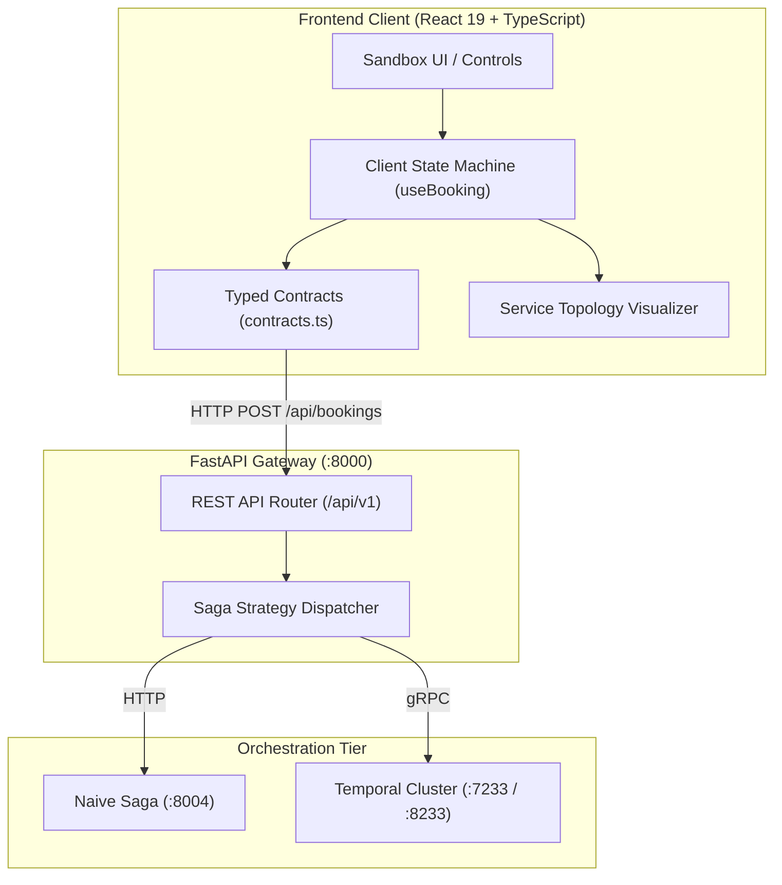

# Reactive Orchestration Dashboard & Typed Client Architecture

## Introduction

> Architected and implemented a high-performance React 19 single-page application (`ui/`) as an external client adapter for **Software Engineering (LO1)**. Designed with TypeScript strict type boundaries, finite state machine visualization, live telemetry timers, and deep-linking into Temporal Web UI, providing an empirical control surface to trigger distributed Saga executions and observe fault tolerance in real time.

---

## Context and the Problem

In distributed systems research, evaluating architectural trade-offs (such as in-memory rollbacks versus durable event-driven execution) requires observing system dynamics under live conditions. 

Interacting with distributed microservices solely via command-line utilities (`curl`) or Postman introduces significant cognitive friction:
1. **Asynchronous Blindness:** CLI tools wait synchronously or fail silently on network timeouts without displaying which intermediate steps succeeded or were compensated.
2. **Topology Decoupling:** Testing multi-service failures (e.g., flight reserved, hotel failing, compensation in reverse) requires correlating database queries across three distinct SQLite files (`flight.db`, `hotel.db`, `payment.db`).
3. **Manual Parameter Coordination:** Altering booking parameters (customer balance, hotel room pricing, flight seats, intentional latency delays) manually in JSON payloads is error-prone.

To satisfy **Software Engineering (LO1)**, I engineered an autonomous, production-grade frontend client that treats the backend as a black-box API Gateway, visualizes distributed state transitions deterministically, and controls fault-injection parameters through typed contracts.

---

## Systems Thinking: Hexagonal Client Architecture

In modern distributed software engineering, the frontend is not merely a visual template; it functions as a primary **Driving Adapter (Client Port)** within Hexagonal Architecture (Ports and Adapters):



### Architectural Principles Applied:
1. **Zero Domain Knowledge Leaks:** The UI communicates exclusively with the API Gateway on port `8000`. It has no knowledge of internal database structures, gRPC connections, or microservice ports (`8001`, `8002`, `8003`, `8004`).
2. **Mirror Contract Boundaries:** Request and response interfaces in `contracts.ts` mirror backend Pydantic models with strict TypeScript types, enforcing end-to-end contract safety.
3. **Deterministic State Reflection:** The UI does not infer business outcomes. It renders the exact state reported by the orchestrator (`steps_completed`, `compensations_executed`, `status`).

---

## Progressive Engineering Steps

### 1 Typesafe Data Contracts & Runtime Validation

To guarantee seamless interoperability between TypeScript and FastAPI/Pydantic, I defined explicit data models and runtime validation guards in `ui/src/api/contracts.ts`:

```typescript
export type ScenarioKey = 'happy_path' | 'fail_payment' | 'fail_hotel' | 'slow_demo' | 'custom';
export type Orchestrator = 'temporal' | 'naive';

export interface BookingRequest {
  orchestrator: Orchestrator;
  scenario: ScenarioKey;
  booking_id?: string;
  customer_id?: string;
  flight_number?: string;
  flight_price?: number;
  hotel_name?: string;
  hotel_price?: number;
  delay_seconds?: number;
}

export interface BookingResponse {
  booking_id: string;
  orchestrator: string;
  scenario: string;
  status: string;
  total_amount: number;
  steps_completed: string[];
  compensations_executed: string[];
  error_message?: string | null;
  temporal_ui_url?: string | null;
}
```

By decoupling raw network transport from application logic, any schema deviation (e.g., unexpected error structure or missing fields) is caught and handled gracefully at the boundary.

---

### 2 Reactive Finite State Machine (`ServiceTopology.tsx`)

Distributed sagas operate as state machines. To make this visible to engineers, I implemented `ServiceTopology.tsx`, which dynamically evaluates the state of each participating service (`Flight`, `Hotel`, `Payment`) based on execution telemetry:

```typescript
type ServiceState = 'idle' | 'running' | 'success' | 'failed' | 'compensated';

function resolveState(serviceName: string, outcome: BookingResponse | null, isPending: boolean): ServiceState {
  if (isPending) return 'running';
  if (!outcome) return 'idle';

  const completed = outcome.steps_completed.includes(serviceName);
  const compensated = outcome.compensations_executed.includes(serviceName);

  if (compensated) return 'compensated';
  if (completed) return 'success';
  if (outcome.status === 'FAILED') return 'failed';
  return 'idle';
}
```

The component renders visual cues:
* **Green pulse:** Step succeeded and committed forward.
* **Amber / Orange badge:** Step was rolled back via compensating action (e.g., `cancel_hotel`, `refund_payment`).
* **Red badge:** Point of failure where transaction was aborted.
* **Blue spinner:** In-flight execution active during intentional delay tests.

---

### 3 Telemetry & Live Latency Instrumentation (`useElapsed.ts`)

When running chaos experiments (such as testing whether `docker kill` aborts a step during the 4-second delay window), precise timing observation is crucial. I developed a custom telemetry hook:

```typescript
export function useElapsed(isRunning: boolean): number {
  const [elapsed, setElapsed] = useState(0);

  useEffect(() => {
    if (!isRunning) return;
    const start = performance.now();
    const interval = setInterval(() => {
      setElapsed(Math.round(performance.now() - start));
    }, 50);

    return () => clearInterval(interval);
  }, [isRunning]);

  return isRunning ? elapsed : 0;
}
```

This updates a millisecond-precision stopwatch during active executions, allowing operators to visually confirm when a service delay is active and time their manual chaos commands (`docker kill layover-naive`) with complete accuracy.

---

### 4 Deep-Linking into Durable Workflow History

When using Temporal orchestration, workflow execution produces an append-only event history inside Temporal Server.

To integrate this developer workflow, the API Gateway returns `temporal_ui_url` when `orchestrator === 'temporal'`. The frontend (`ExecutionSummary.tsx`) dynamically renders an external deep-link:

```tsx
{outcome.temporal_ui_url && (
  <a
    href={outcome.temporal_ui_url}
    target="_blank"
    rel="noopener noreferrer"
    className="temporal-link-button"
  >
    View in Temporal Web UI ↗
  </a>
)}
```

This allows immediate transition from high-level application observation to low-level event-history inspection (`ActivityTaskScheduled`, `ActivityTaskCompleted`, `WorkflowExecutionCompleted`) in the native Temporal UI on port `8233`.

---

## Key Decisions and Trade-offs

| Decision | Alternative Considered | Engineering Rationale |
| :--- | :--- | :--- |
| **Vanilla CSS with Design Tokens** | TailwindCSS or component libraries (MUI, AntD) | Zero runtime overhead, complete styling control, and zero external build pipeline fragility. Clean glassmorphic design matching modern developer tool standards. |
| **Single API Gateway Facade** | Direct client-to-microservice calls (CORS across 5 ports) | Prevents browser CORS complications, isolates client from internal topology changes, and provides single point for auth, validation, and telemetry. |
| **Mockable Async Client (`gateway.ts`)** | Axios or global `window.fetch` | Encapsulates network communication into an injectable module, allowing 100% deterministic unit testing with Vitest without mocking browser globals. |

---

## Verification & Automated Testing

The UI codebase is verified through an automated testing harness in Vitest (`ui/tests/`), running **45 automated tests**:

```bash
cd ui && npm test
```

```text
 ✓ tests/bookingStorage.test.ts (4 tests)
 ✓ tests/bookingPresentation.test.ts (6 tests)
 ✓ tests/PriceSummary.test.tsx (5 tests)
 ✓ tests/gateway.test.ts (11 tests)
 ✓ tests/App.test.tsx (19 tests)

 Test Files  5 passed (5)
      Tests  45 passed (45)
   Start at  00:46:12
   Duration  1.48s
```

### Verified Behaviors:
1. **Contract Parsing:** Validates that malformed responses or HTTP 500 errors from the Gateway do not crash the React rendering tree (`ErrorBoundary`).
2. **Scenario Selection:** Switching between `happy_path`, `fail_hotel`, `fail_payment`, and `slow_demo` correctly updates expected totals and request payloads.
3. **State Machine Transitions:** Confirms that `ServiceTopology` properly maps `steps_completed` and `compensations_executed` to their respective status states.
4. **Vite Production Compilation:** Validates that TypeScript type checking (`tsc`) and bundle minification pass with zero warnings or errors (`npm run build`).

---

## Reflection & Learning Outcome Justification

* **Software Engineering (LO1):** Built a structured, client-side driving adapter adhering to Ports and Adapters, TypeScript contract boundaries, and reactive state management. Designed a cohesive developer experience facilitating live distributed fault-injection research.
* **Software Quality (LO2):** Ensured full test coverage of UI logic with 45 unit and component tests verifying contract parsing, state machines, and error resilience.
