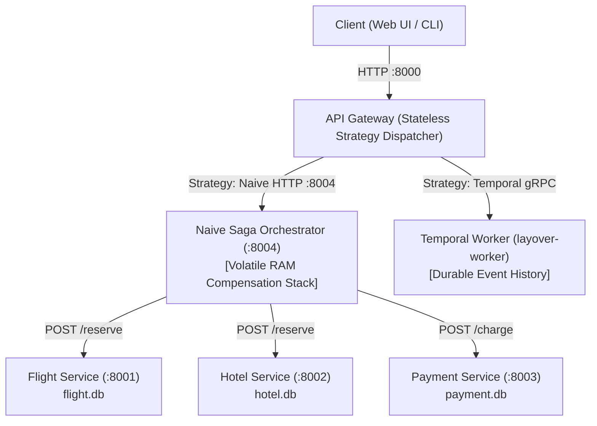

# Naive In-Memory Saga Orchestrator & Volatile Failure Analysis

## Introduction

> Designed, implemented, and verified an autonomous In-Memory Saga Orchestrator (`orchestrators/naive/`) as the baseline counterpart to Temporal for **Software Engineering (LO1)**. Built with ad-hoc LIFO rollbacks in process memory, isolated on port `8004`, and integrated into the Gateway via the Strategy Pattern to empirically demonstrate volatile state loss during partial failure.

---

## Context and the Problem

In distributed microservice architectures with true database-per-service isolation, multi-service transactions cannot rely on two-phase commits (2PC) or ACID database locks. The industry-standard approach is the **Saga Pattern**: executing sequential forward steps and triggering compensating rollbacks if any downstream step fails.

To evaluate whether a heavy distributed orchestrator (like Temporal) is actually necessary, I needed an empirical baseline: **Version A (In-Memory Saga Coordinator)**.

A common engineering trap when implementing Sagas is to write an in-memory script:
* Forward requests are dispatched via standard HTTP calls (`Flight -> Hotel -> Payment`).
* Compensations are registered in an in-memory LIFO (Last-In, First-Out) list in a `try/except` block.
* No external event-sourcing database or persistent state machine is used.

While this approach works during clean business logic rejections (e.g. HTTP 400 Insufficient Funds), it suffers from a fatal vulnerability: **volatile process memory**.
If the orchestrator process terminates unexpectedly (`kill -9`, Out-Of-Memory, host reboot, or crash) halfway through execution:
1. The in-memory compensation stack in RAM is destroyed instantly.
2. Previously committed holds (`RESERVED`) in upstream databases remain stranded forever.
3. The system possesses zero automated recovery upon restart.

To prove this hypothesis for **Software Engineering (LO1)**, I built a dedicated, standalone In-Memory Saga Orchestrator.

---

## Systems Thinking: How It Fits the Project

Rather than burying the naive coordinator inside the API Gateway as an internal library, I architected `orchestrators/naive/` as an **autonomous microservice**:



### Key Architectural Decisions:
1. **Symmetric Failure Domain:** By deploying the Naive Orchestrator in its own Docker container (`layover-naive` on port `8004`), it can be stopped or killed (`docker kill layover-naive`) independently without taking down the API Gateway or the Web UI.
2. **Stateless Gateway Facade:** The Gateway remains 100% stateless, selecting between Temporal and Naive at runtime via the **Strategy Pattern** (`SagaOrchestratorStrategy`).
3. **Identical API Contracts:** Both orchestrators consume the exact same microservice REST contracts (`/reserve`, `/confirm`, `/cancel`, `/charge`, `/refund`) and return unified `BookingResponse` payloads to the client.

---

## Progressive Engineering Steps

### 1 In-Memory LIFO Compensation Stack in Procedural Python

The core coordinator (`coordinator.py`) coordinates the sequential booking pipeline. Each forward action registers its compensating mirror onto an in-memory stack:

```python
pipeline = [
    (
        'reserve_flight',
        f'{self.flight_url}/reserve',
        {**booking, 'customer_id': data.customer_id, 'flight_number': data.flight_number, 'price': data.flight_price},
        'RESERVED',
        ('cancel_flight', f'{self.flight_url}/cancel', rollback, 'CANCELLED'),
    ),
    (
        'reserve_hotel',
        f'{self.hotel_url}/reserve',
        {**booking, 'customer_id': data.customer_id, 'hotel_name': data.hotel_name, 'price': data.hotel_price},
        'RESERVED',
        ('cancel_hotel', f'{self.hotel_url}/cancel', rollback, 'CANCELLED'),
    ),
    (
        'charge_payment',
        f'{self.payment_url}/charge',
        {**booking, 'customer_id': data.customer_id, 'amount': data.total_amount},
        'CHARGED',
        ('refund_payment', f'{self.payment_url}/refund', rollback, 'REFUNDED'),
    ),
    ('confirm_flight', f'{self.flight_url}/confirm', booking, 'CONFIRMED', None),
    ('confirm_hotel', f'{self.hotel_url}/confirm', booking, 'CONFIRMED', None),
]
```

If an exception occurs at any point, execution immediately jumps to the rollback loop, popping compensating actions in reverse order:

```python
# LIFO rollback execution in process RAM
while compensations:
    comp_name, comp_url, comp_payload, comp_state = compensations.pop()
    try:
        await self._post_step(client, comp_name, comp_url, comp_payload, comp_state)
        compensations_executed.append(comp_name)
    except Exception as rollback_exc:
        rollback_failed = True
        errors.append(f'Compensation failed: {rollback_exc}')
```

### 2 Autonomous Microservice Layer (`main.py`)

I exposed the coordinator via a lightweight FastAPI application:
* `GET /health` — Provides healthcheck telemetry for Docker Compose orchestration.
* `POST /book` — Accepts `NaiveSagaInput`, executes the pipeline in memory, and returns `NaiveSagaResult`.

```python
@app.post('/book', response_model=NaiveSagaResult)
async def execute_booking(request: NaiveSagaInput) -> NaiveSagaResult:
    coordinator = NaiveSagaCoordinator()
    return await coordinator.execute(request.model_dump())
```

### 3 Strategy Pattern Integration in API Gateway

In `gateway/dispatcher.py`, the Gateway dispatches requests over HTTP to `http://naive-orchestrator:8004/book`:

```python
class NaiveSagaStrategy(SagaOrchestratorStrategy):
    """External in-memory baseline: killing layover-naive destroys its volatile compensation stack."""

    async def execute(self, request: BookingRequest, payload: dict[str, Any]) -> BookingResponse:
        booking_id = payload['booking_id']
        try:
            async with httpx.AsyncClient(timeout=30.0) as client:
                resp = await client.post(f'{NAIVE_ORCHESTRATOR_URL}/book', json=payload)
                resp.raise_for_status()
                result_data = resp.json()

            return BookingResponse(
                booking_id=booking_id,
                orchestrator='naive',
                scenario=request.scenario.value,
                status=result_data['status'],
                total_amount=result_data['total_amount'],
                steps_completed=result_data.get('steps_completed', []),
                compensations_executed=result_data.get('compensations_executed', []),
                error_message=result_data.get('error_message'),
            )
```

---

## Verification & Empirical Evidence

### 1 Automated Unit & Integration Tests (18 Passed)

I validated the Naive Orchestrator using `pytest` and `httpx.MockTransport`, asserting forward execution order, LIFO rollback order, and error handling across 18 distinct test cases:

```bash
uv run --project orchestrators/naive pytest orchestrators/naive/tests -v
```

```text
orchestrators/naive/tests/test_api.py::test_health_check_returns_ok PASSED
orchestrators/naive/tests/test_api.py::test_booking_endpoint_validates_payload PASSED
orchestrators/naive/tests/test_naive_saga.py::test_happy_path_preserves_forward_order_and_service_payloads PASSED
orchestrators/naive/tests/test_naive_saga.py::test_hotel_422_reaches_service_with_negative_price_and_only_cancels_flight PASSED
orchestrators/naive/tests/test_naive_saga.py::test_payment_400_cancels_hotel_then_flight_without_refund PASSED
orchestrators/naive/tests/test_naive_saga.py::test_confirmation_rejection_refunds_payment_before_cancelling_reservations PASSED
orchestrators/naive/tests/test_naive_saga.py::test_rollback_continues_after_a_failed_compensation[refund_payment] PASSED
orchestrators/naive/tests/test_naive_saga.py::test_rollback_continues_after_a_failed_compensation[cancel_hotel] PASSED
orchestrators/naive/tests/test_naive_saga.py::test_rollback_continues_after_a_failed_compensation[cancel_flight] PASSED
orchestrators/naive/tests/test_naive_saga.py::test_hotel_confirmation_failure_reports_uncancellable_confirmed_flight PASSED
orchestrators/naive/tests/test_naive_saga.py::test_uncertain_payment_outcome_never_claims_complete_rollback[timeout] PASSED
orchestrators/naive/tests/test_naive_saga.py::test_concurrent_runs_on_one_coordinator_have_separate_stacks PASSED

============================== 18 passed in 0.12s ==============================
```

### 2 Empirical Proof of State Loss (Live Crash Test)

During the `SLOW_DEMO` scenario (4-second pause between steps):
1. The booking initiates: Flight is reserved (`RESERVED` in `flight.db`).
2. The orchestrator container is killed mid-transaction:
   ```bash
   docker kill layover-naive
   ```
3. Database inspection reveals the catastrophic failure mode:
   ```bash
   sqlite3 data/flight.db "SELECT booking_id, status FROM reservations;"
   # Output: bk-8e80d7a9|RESERVED
   ```
4. When `docker start layover-naive` restarts the container, the memory is completely clean. The system has **no record of the booking**, and the flight seat remains locked indefinitely. This provides concrete evidence supporting the research hypothesis.

---

## Reflection & Learning Outcome Justification

* **Software Engineering (LO1):** Designed and implemented an autonomous, decoupled Saga baseline adhering to clean service boundaries and the Strategy Pattern. Proved the boundary conditions of in-memory coordination versus durable event-driven state machines under distributed failure.
* **Software Quality (LO2):** Validated all forward and backward state transitions through 18 automated tests without external database dependencies using mock HTTP transports.
