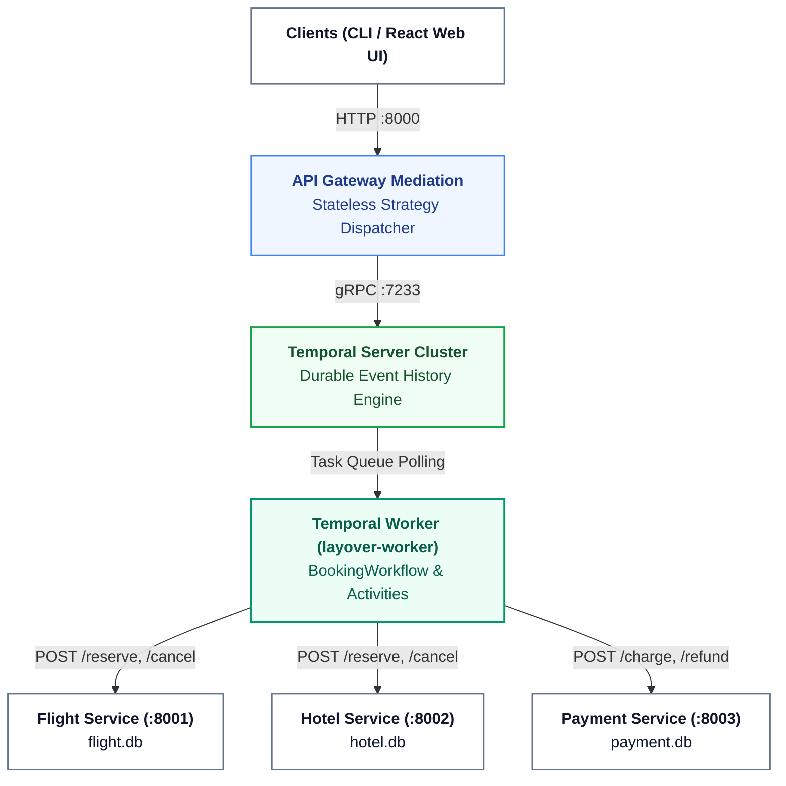
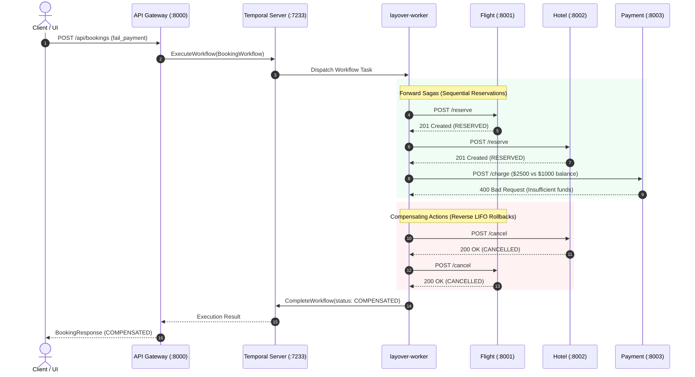

# Temporal Saga Orchestration & Distributed Compensations

## Introduction

> Designed and implemented a durable travel booking orchestrator using the Saga Pattern and Temporal Python SDK, featuring automated LIFO compensation rollbacks, decoupled Gateway mediation, and an in-memory time-skipping integration test harness for **Software Engineering (LO1)**.

---

## Context and the Problem

In a distributed microservice architecture with true database-per-service isolation, multi-service workflows (such as booking a flight, reserving a hotel, and charging a customer's payment card) cannot rely on ACID database transactions.

If any service encounters a failure mid-transaction (such as an overbooked hotel or insufficient funds on the payment step), naive implementations leave the system in an inconsistent "zombie" state:

* Flights remain reserved indefinitely without payment.
* Hotel inventory is blocked, preventing other customers from booking.
* Customers risk being billed for failed bookings if errors occur during subsequent steps.

To solve this problem for **Software Engineering (LO1)** and **Software Quality (LO2)**, I needed a durable workflow engine that guarantees eventual consistency across microservices through the **Saga Pattern**: executing forward steps sequentially and automatically triggering compensating actions in reverse order whenever partial failures strike.

---

## Systems Thinking: How It Fits the Project

I structured the orchestration layer around the **Ports & Adapters (Hexagonal)** architectural pattern:



* **Consumer Layer (`clients/`):** Thin interface adapters (the `cli.py` tool and the React/Vite dashboard). They are decoupled from workflow execution internals.
* **Mediation Layer (`gateway/`):** The Application Service layer defining unified contracts (`BookingRequest`, `BookingResponse`), pre-flight healthcheck engines, and predefined scenario profiles (`happy_path`, `fail_hotel`, `fail_payment`).
* **Durable Orchestration Layer (`orchestrators/temporal/`):** The core Saga coordinator executing deterministic workflows and activities backed by Temporal's event-sourcing engine.
* **Microservices Layer (`services/`):** Autonomous REST microservices exposing symmetric forward actions (`/reserve`, `/charge`) and compensating actions (`/cancel`, `/refund`).

This separation ensures that both coordinators (Naive and Temporal) implement the exact same Gateway contract without coupling clients directly to workflow engines.

---

## Progressive Engineering Steps

I implemented and verified the Saga orchestrator across four progressive iterations:

### 1 Activity Segregation & Error Classification

Temporal activities encapsulate all non-deterministic side effects (HTTP REST requests):

* **Forward Activities:** `reserve_flight`, `reserve_hotel`, `charge_payment`, `confirm_flight`, `confirm_hotel`.
* **Compensating Activities:** `cancel_flight`, `cancel_hotel`, `refund_payment`.

A critical engineering challenge in workflow design is error classification:

* **Transient Network Failures (Retryable):** If a service is briefly unreachable due to network blips (`httpx.RequestError`), the activity raises a standard error, allowing Temporal's `RetryPolicy` to automatically retry with exponential backoff.
* **Deterministic Domain Rejections (Non-Retryable):** If a service returns `400 Bad Request` (insufficient funds) or `409 Conflict` (already booked), retrying is useless. The activity raises `ApplicationError(..., non_retryable=True)`, immediately failing the activity and triggering the Saga rollback without delay:

```python
@activity.defn
async def charge_payment_activity(request: PaymentChargeRequest) -> PaymentResponse:
    """Charges customer account in Payment Service."""
    url = f'{get_payment_url()}/charge'
    async with httpx.AsyncClient(timeout=10.0) as client:
        try:
            response = await client.post(url, json=request.model_dump())
        except httpx.RequestError as exc:
            # Transient error: retry with exponential backoff
            raise ApplicationError(f'Payment service unreachable: {exc}', non_retryable=False)

    if response.status_code in (200, 201):
        return PaymentResponse(**response.json())

    # Deterministic domain rejection (e.g. 400 Insufficient Funds): fail immediately
    raise ApplicationError(
        f'Payment charge rejected ({response.status_code}): {response.text}',
        non_retryable=True,
    )
```

### 2 Deterministic Workflow & Dynamic LIFO Compensation Stack

The `BookingWorkflow` coordinates the transaction lifecycle:

1. As each forward activity completes successfully, its corresponding compensating activity is pushed onto an in-memory **LIFO (Last-In, First-Out) stack**.
2. If any step fails or is rejected, the workflow catches the error and unwinds the registered compensations in reverse order:

```python
# Rollback registered compensations in reverse order (LIFO)
for comp_func, comp_arg, comp_name in reversed(compensations):
    try:
        workflow.logger.warning(f'Executing compensation: {comp_name}')
        await workflow.execute_activity(
            comp_func,
            comp_arg,
            start_to_close_timeout=timedelta(seconds=10),
            retry_policy=COMPENSATION_RETRY_POLICY,
        )
        compensations_executed.append(comp_name)
    except Exception as comp_exc:
        workflow.logger.critical(f'Compensation {comp_name} failed: {comp_exc}')
        all_compensations_succeeded = False
```

3. If all compensations succeed, the workflow returns `status='COMPENSATED'` along with the complete audit trail of what was reserved and what was rolled back.

### 3 Decoupled Gateway Mediation & Scenario Profiles

To make testing and demonstration repeatable, I implemented the `gateway/` module:

* **On-Demand Healthcheck (`health.py`):** Queries `/health` on all three microservices and checks gRPC connectivity to Temporal (`:7233`).
* **Scenario Profiles (`scenarios.py`):**
  * `happy_path`: Customer `user_1`, total price $400 $\rightarrow$ completes and confirms all steps (`CONFIRMED`).
  * `fail_hotel`: Negative price triggering `422 Unprocessable` at Hotel service $\rightarrow$ triggers flight cancellation (`COMPENSATED`).
  * `fail_payment`: Price $2500 on customer with $1000 balance $\rightarrow$ triggers hotel and flight cancellations in LIFO order (`COMPENSATED`).
* **Unified Dispatcher (`dispatcher.py`):** Connects to Temporal, submits the workflow, and packages the result into a clean `BookingResponse`:

```python
async def dispatch_booking(request: BookingRequest) -> BookingResponse:
    # Resolve scenario input
    scenario_input = get_scenario_input(request.scenario, request.booking_id)
    
    # Execute workflow on Temporal
    client = await get_temporal_client()
    result = await client.execute_workflow(
        BookingWorkflow.run,
        scenario_input,
        id=request.booking_id,
        task_queue='booking-task-queue',
    )
    return BookingResponse.from_workflow_result(result)
```

### 4 Automated Time-Skipping Test Harness

To test distributed workflows without relying on slow sleep timers or live cluster setup in CI, I wrote an automated integration test suite in `tests/test_booking_saga.py`:

* Leverages `temporalio.testing.WorkflowEnvironment.start_time_skipping()`.
* Combines Temporal's in-memory server with `respx` to mock external microservice HTTP responses.
* Runs tests at in-memory speed (all scenarios execute in under 1 second):

```text
tests/test_booking_saga.py::test_booking_saga_happy_path PASSED          [ 16%]
tests/test_booking_saga.py::test_booking_saga_hotel_failure_rollback PASSED [ 33%]
tests/test_booking_saga.py::test_booking_saga_payment_failure_rollback PASSED [ 50%]
tests/test_replay.py::test_replay_happy_path_history PASSED              [ 66%]
tests/test_replay.py::test_replay_compensated_history PASSED             [ 83%]
tests/test_replay.py::test_replay_detects_non_deterministic_divergence PASSED [100%]

============================== 6 passed in 1.06s ===============================
```

---

## Key Decisions and What I Validated

### Saga Pattern vs. Two-Phase Commit (2PC)

Traditional distributed transaction models like 2-Phase Commit (2PC) require distributed locking across databases. In a microservices environment, 2PC is an anti-pattern:

* It couples services together synchronously.
* If the coordinator crashes while holding locks, resources remain frozen across all databases.

By adopting the **Saga Pattern**, each microservice commits its local transaction immediately inside its own database. If a subsequent step fails, compensating actions (`/cancel`, `/refund`) undo the effects semantically. This maximizes availability and service autonomy.

### Dynamic LIFO Stack vs. Hardcoded Nested Try/Catch

A naive approach to error recovery is nesting `try/except` blocks inside procedural code. As the number of steps increases, nested error handling becomes unmaintainable ("Pyramid of Doom").

I utilized a dynamic **LIFO compensation stack**:

```python
compensations.append((cancel_flight_activity, flight_cancel_req, 'cancel_flight'))
```

When an error occurs at step $N$, the rollback engine simply iterates `reversed(compensations)`:

* Flight succeeded, Hotel failed $\rightarrow$ runs `cancel_flight`.
* Flight succeeded, Hotel succeeded, Payment failed $\rightarrow$ runs `cancel_hotel`, then `cancel_flight`.

The rollback logic is clean, scalable to any number of steps, and automatically adapts to where the failure occurred.

### Validating Recovery in Temporal Web UI



I verified the workflow's real-time visibility using the Temporal Web UI (`http://localhost:8233`):

```text
Workflow Execution: wf-fail-payment-1
├── ActivityTaskScheduled:   reserve_flight_activity (Completed)
├── ActivityTaskScheduled:   reserve_hotel_activity  (Completed)
├── ActivityTaskScheduled:   charge_payment_activity (Failed: 400 Insufficient Funds)
├── ActivityTaskScheduled:   cancel_hotel_activity   (Completed)
└── ActivityTaskScheduled:   cancel_flight_activity  (Completed)
Result Status: COMPENSATED
```

The event history provides an immutable audit log: exact timestamps, payloads, retry attempts, and rollback outcomes are permanently visible for debugging and compliance.

---

## Reflection & Learning Outcome Justification

* **Software Engineering (LO1):** Architected and implemented a durable Saga orchestrator using Temporal's Python SDK, enforcing decoupling through the Ports & Adapters pattern and guaranteeing eventual consistency via automated LIFO compensations.
* **Software Quality (LO2):** Formulated an in-memory time-skipping test harness and deterministic replay tests, validating that all forward and compensating workflow paths execute correctly without external dependencies.
