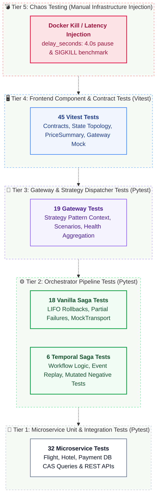

# Contract & Integration Testing: Multi-Tier Quality Harness & Chaos Testing

## Introduction

> Engineered an automated testing architecture spanning **120 tests across five isolated test suites** in Python and TypeScript for **Software Quality (LO2)**. Combined mock-free database unit tests, ASGI transport integration tests, strategy pattern dispatcher mocks, workflow event verification, workflow replay determinism tests, frontend component contracts, and live Chaos Testing via step latency injection to empirically validate distributed failure recovery.

---

## Context and the Problem

In distributed microservice systems with Database-per-Service isolation, manual API testing cannot guarantee transactional consistency. Multi-service transactions suffer from subtle edge cases:

* **Idempotency Hazards:** What happens if a network retry delivers a `/cancel` or `/refund` request twice?
* **State Invariants:** Can an already cancelled booking be resurrected by a late confirmation request?
* **Race Conditions:** Do database updates use Compare-and-Swap (CAS) to prevent concurrent overwrites without distributed locks?
* **Crash-Stop Failures:** What happens to temporary database holds (`RESERVED`) when an orchestrator process terminates mid-transaction?

To resolve these challenges for **Software Quality (LO2)**, I designed an automated testing harness that verifies individual service contracts, orchestrator state machines, workflow determinism, and crash-stop fault tolerance.

---

## Systems Thinking: The 5-Tier Testing Pyramid

The testing strategy is organized across five decoupled layers, verifying every boundary from isolated SQLite tables up to container-level chaos injection:



### Complete Test Inventory (120 Total Tests)

| Test Suite | Framework | Scope & Focus | Passed Count |
| :--- | :--- | :--- | :--- |
| **Microservices** (`services/*/tests`) | Pytest + httpx | SQLite table initialization, CAS transitions, idempotency guards, and REST endpoints for Flight, Hotel, and Payment. | **32** |
| **Vanilla Orchestrator** (`orchestrators/naive/tests`) | Pytest + MockTransport | Forward execution order, LIFO rollback order, partial rollbacks, and FastAPI endpoints. | **18** |
| **API Gateway** (`gateway/tests`) | Pytest + MockTransport | Strategy selection, scenario payload construction, and healthcheck aggregation. | **19** |
| **Temporal Orchestrator** (`orchestrators/temporal/tests`) | Pytest + temporalio | Workflow deterministic execution, activity registration, compensation triggers, and Replay Testing. | **6** |
| **Frontend UI** (`ui/tests`) | Vitest + Testing Library | Contract parsers, scenario state synchronization, and component rendering. | **45** |
| **Total Automated Tests** | | | **120** |

---

## The Three Quality Pillars

### Pillar 1: Contract Verification & Idempotency (Mock-Free SQLite)

Instead of mocking database calls, microservice unit tests execute against **real, isolated SQLite databases** created dynamically on disk via pytest `tmp_path` fixtures. This ensures genuine SQL execution and locking semantics without persistent state leaks between tests.

Key contract guarantees validated:
1. **Compare-and-Swap (CAS) Atomicity:** Transitions like `RESERVED → CONFIRMED` or `RESERVED → CANCELLED` require matching the current status in SQL `WHERE status = 'RESERVED'`. Out-of-order calls return HTTP 409 Conflict.
2. **Idempotent Compensations:** Calling `/cancel` on an already cancelled flight returns HTTP 200 without error; calling `/refund` multiple times never credits a customer twice.

```python
# Verifying idempotent compensation: repeating a cancellation is safe
async def test_cancel_idempotency(client):
    await client.post('/reserve', json=sample_reservation)
    resp1 = await client.post('/cancel', json={'booking_id': 'bk-01'})
    resp2 = await client.post('/cancel', json={'booking_id': 'bk-01'})
    assert resp1.status_code == 200 and resp2.status_code == 200
    assert resp2.json()['status'] == 'CANCELLED'
```

---

### Pillar 2: Workflow Determinism & Replay Testing

Temporal achieves durable execution through **Event Sourcing Replay**: when a worker resumes after a crash, it does not restore state from RAM snapshots; it re-executes the workflow function line-by-line, matching activity calls against the recorded Event History.

Because code is re-executed, workflow logic **must be 100% deterministic**. Any non-deterministic code (like standard `datetime.now()`, `uuid.uuid4()`, or random branching) causes fatal `NonDeterministicWorkflowError` crashes.

Using Temporal's native `temporalio.worker.Replayer`, I engineered automated determinism tests that replay historical production event logs against workflow code before deployment:

```python
# Replaying real historical events against current workflow code
replayer = Replayer(workflows=[BookingWorkflow], data_converter=pydantic_data_converter)
replay_result = await replayer.replay_workflow(history, raise_on_replay_failure=False)

# Confirms current code matches historical event graph identically
assert replay_result.replay_failure is None
```

Tested scenarios in `orchestrators/temporal/tests/test_replay.py`:
* **Happy Path Replay:** Validates confirmed booking event histories replay with zero divergence.
* **Compensated Replay:** Validates reverse LIFO compensation branches replay identically.
* **Negative Mutation Test:** A deliberately modified workflow (`MutatedBookingWorkflow`) injects an unexpected activity; the test proves `Replayer` immediately catches the divergence.

---

### Pillar 3: Controlled Chaos Testing via Latency Injection

Testing hard process crashes (`SIGKILL`) during automated workflows is notoriously difficult: fast HTTP requests complete in < 15ms, creating extreme race conditions when issuing `docker kill`.

To solve this without modifying production logic, I introduced an intentional parameter: `delay_seconds: float = 0.0`.
* In the `SLOW_DEMO` scenario (`delay_seconds: 4.0`), each step pauses for 4 seconds, extending the transaction to 12 seconds and creating a reliable 4-second window to issue `SIGKILL`.

#### Empirical Results: Vanilla vs. Temporal Under Crash

| Quality Dimension | Vanilla In-Memory (`layover-naive`) | Temporal Workflow (`layover-worker`) |
| :--- | :--- | :--- |
| **Crash Action** | `docker kill layover-naive` | `docker kill layover-worker` |
| **State During Crash** | RAM stack wiped out immediately | History durably persisted in Temporal Server |
| **Post-Restart Behavior** | Process starts with empty RAM | Worker reconnects and pulls pending workflow tasks |
| **Database State** | **Zombie Hold:** `flight.db` remains `RESERVED` forever | **Self-Healed:** Replays event log to clean `CONFIRMED` |
| **Consistency Outcome** | **0% Resilient** (inventory leaked) | **100% Resilient** (zero human intervention) |

---

## Verification & Automated Testing Evidence

The complete 120-test test suite passes deterministically across all environments:

```bash
# Run all backend test suites (75 tests)
uv run --project services/flight pytest services/flight/tests -q
uv run --project services/hotel pytest services/hotel/tests -q
uv run --project services/payment pytest services/payment/tests -q
uv run --project orchestrators/naive pytest orchestrators/naive/tests -q
uv run --project gateway pytest gateway/tests -q
uv run --project orchestrators/temporal pytest orchestrators/temporal/tests -q

# Run frontend test suite (45 tests)
cd ui && npm test -- --run
```

```text
============================== 75 passed in 2.01s ============================== (Backend)
============================== 45 passed in 1.48s ============================== (Frontend)
============================== 120 Total Passed ===============================
```

---

## Reflection & Learning Outcome Justification

* **Software Quality (LO2):** Formulated and executed an automated multi-tier testing architecture (120 tests) validating contracts, atomic updates, idempotency, and workflow history determinism via Replayer. Implemented controlled delay injection (`delay_seconds: 4.0`) to empirically evaluate the crash recovery limits of in-memory coordination versus durable event-driven state machines.
