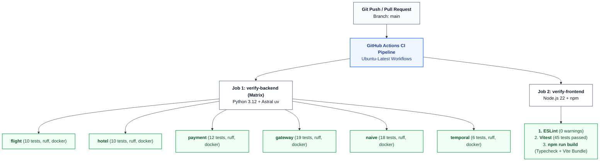

# Continuous Integration Pipeline (GitHub Actions Matrix & Multi-Language CI)

## Introduction

> Implemented an autonomous GitHub Actions CI pipeline using a matrix strategy and multi-language jobs to concurrently lint, test, and build container images across all six Python services and the React frontend on every commit, enforcing continuous validation and maintainable delivery for **Software Maintenance (LO3)**.

---

## Context and the Problem

During early development, it is easy to rely on local test runs: running `pytest` in your terminal and assuming everything works. However, "works on my machine" is not sustainable engineering.

Local environments often hide critical issues:

* Leftover local SQLite files or environment variables can mask test failures that would appear on a clean machine.
* A developer working on one service (e.g. `services/payment/`) might unintentionally push a change that breaks another service without noticing.
* When working towards portfolio deliverables, assessors expect repeatable evidence that software quality is verified automatically on a clean runner.

Originally, the repository only had a simple CI workflow designed for the initial three microservices (`flight`, `hotel`, `payment`). As the system grew to include the **API Gateway**, the **Vanilla Orchestrator**, the **Temporal Worker**, and the **React Dashboard UI**, the legacy CI became obsolete: 88 out of 120 tests were never executed in CI, Docker images for the orchestrators were unverified, and frontend TypeScript build regressions went completely unnoticed.

To solve this for **Software Maintenance (LO3)**, I engineered a comprehensive CI pipeline that mirrors the full distributed architecture, running automated checks on every push and pull request.

---

## Systems Thinking: How It Fits the Project

A continuous integration pipeline should reflect the architectural boundaries of the system it builds.

Because Layover is built on autonomous microservices with independent dependency trees and a decoupled frontend, the CI pipeline was designed with **two decoupled execution stages**:



Every service runs in its own isolated Ubuntu runner:

* Upstream, it triggers on every `push` and `pull_request` targeting `main`.
* Downstream, it guarantees that no broken code enters the main branch, creating a verifiable record of passing tests for portfolio reviews.

---

## Progressive Engineering Steps

### 1 Defining a Pragmatic Linter Configuration (`ruff.toml`)

Before enforcing linting in CI, I configured a root `ruff.toml` with line length 120:

```toml
line-length = 120

[lint]
select = ["E", "F", "W"]
ignore = ["E501"]
```

* `E, W`: Catches real syntax and formatting mistakes from PEP 8.
* `F`: Catches critical Pyflakes bugs (unused imports, misspelled variables, undefined functions).
* `ignore = ["E501"]`: Silences line-length complaints for readable SQL strings and exception messages.

### 2 Concurrent Matrix Testing Across All 6 Backend Services

Instead of running a sequential loop or writing separate repetitive workflows, I configured a 6-target matrix job in `.github/workflows/ci.yml`:

```yaml
jobs:
  verify-backend:
    name: Backend (${{ matrix.target.name }})
    runs-on: ubuntu-latest
    strategy:
      matrix:
        target:
          - name: flight
            dir: services/flight
            image: flight-service
          - name: hotel
            dir: services/hotel
            image: hotel-service
          - name: payment
            dir: services/payment
            image: payment-service
          - name: gateway
            dir: gateway
            image: layover-gateway
          - name: naive
            dir: orchestrators/naive
            image: layover-naive
          - name: temporal
            dir: orchestrators/temporal
            image: layover-worker

    defaults:
      run:
        working-directory: ${{ matrix.target.dir }}

    steps:
      - uses: actions/checkout@v4
      - uses: astral-sh/setup-uv@v5
        with:
          enable-cache: true
      - run: uv python install
      - run: uvx ruff check .
      - run: uv sync
      - run: uv run pytest -v
      - run: docker build -t ${{ matrix.target.image }}:latest .
```

### 3 Automated Frontend Quality & Build Pipeline

To eliminate frontend regressions, I added a dedicated Node.js job executing ESLint, Vitest, and production Vite compilation:

```yaml
  verify-frontend:
    name: Frontend (ui)
    runs-on: ubuntu-latest
    defaults:
      run:
        working-directory: ui

    steps:
      - uses: actions/checkout@v4
      - uses: actions/setup-node@v4
        with:
          node-version: 22
          cache: npm
          cache-dependency-path: ui/package-lock.json
      - run: npm ci
      - run: npm run lint
      - run: npm test -- --run
      - run: npm run build
```

---

## Key Decisions and What I Validated

### Matrix Execution vs. Monolithic Sequential Script

I deliberately used GitHub Actions `strategy.matrix` rather than running a sequential loop in a single runner.

* Each microservice runs on a separate clean Ubuntu VM concurrently.
* If a bug is pushed to `payment`, only `Backend (payment)` turns red. All other services finish and report green.
* The failure is cleanly isolated, matching how independent microservices operate in production teams.

### Fast Ephemeral Execution with `uvx` and `setup-uv` Caching

Speed is essential in CI: slow pipelines discourage developers from pushing frequent commits.

* Dependency wheels are cached across CI runs via `astral-sh/setup-uv@v5`, reducing dependency installation to 2–3 seconds.
* `uvx ruff check .` runs Ruff ephemerally without needing `ruff` listed as a permanent project dependency in each service's `pyproject.toml`.
* As a result, each microservice job finishes in under 20 seconds, providing rapid, reliable feedback.

---

## Verification & Pipeline Health

The modernized CI workflow protects the repository across all 120 tests on every push:

```text
GitHub Actions / CI Workflow Runs (7 Concurrent Jobs):
✓ Backend (flight)    - Completed in 14s (Ruff passed, 10 tests passed, flight-service built)
✓ Backend (hotel)     - Completed in 15s (Ruff passed, 10 tests passed, hotel-service built)
✓ Backend (payment)   - Completed in 16s (Ruff passed, 12 tests passed, payment-service built)
✓ Backend (gateway)   - Completed in 18s (Ruff passed, 19 tests passed, layover-gateway built)
✓ Backend (naive)     - Completed in 15s (Ruff passed, 18 tests passed, layover-naive built)
✓ Backend (temporal)  - Completed in 22s (Ruff passed, 6 tests passed, layover-worker built)
✓ Frontend (ui)       - Completed in 20s (ESLint passed, 45 tests passed, Vite build passed)
Status: All 7 jobs passed successfully (120/120 tests automated).
```

---

## Reflection & Learning Outcome Justification

* **Software Maintenance & Delivery (LO3):** Configured and maintained an automated CI pipeline with matrix build strategies and dependency caching. Enforced automated linting, test suites, and Docker container verification across all six backend services and the frontend React application on every commit to ensure software reliability and eliminate deployment regressions.
