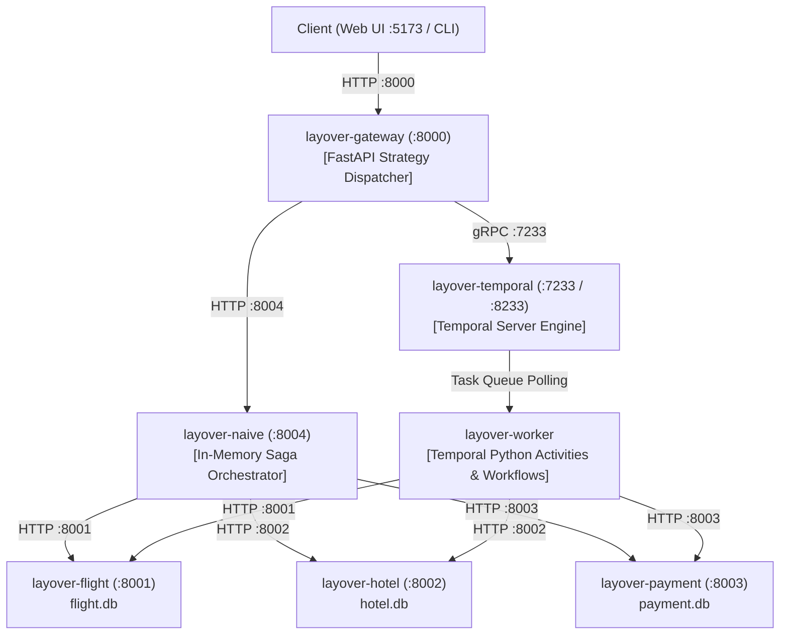

# Docker Containerization & Multi-Service Topology v2: 7-Container Ecosystem

> **Evolution Notice:** This document represents **Version 2** of the Docker Containerization evidence. It builds directly upon [Version 1 (Initial 3-Service Microservice Containerization)](./lo3-docker-containerization.md), expanding the container topology from 3 basic REST microservices to the complete **7-container production-grade distributed ecosystem** with cascading health checks and symmetric failure domains.

---

## Introduction

> Architected, configured, and deployed a 7-container distributed ecosystem via Docker Compose for **Software Maintenance & Delivery (LO3)**. Incorporates multi-stage Astral `uv` caching, non-root runtimes, declarative health-check dependencies, isolated named persistence volumes, and symmetric fault isolation between Temporal and In-Memory Saga engines.

---

## Context and the Evolution from v1

In [Version 1](./lo3-docker-containerization.md), I containerized the foundational three services (`Flight`, `Hotel`, `Payment`) to prevent environment drift and eliminate manual multi-tab terminal execution.

However, as the research progressed from isolated microservices to distributed orchestration and chaos benchmarking, the architectural requirements evolved:
1. **Durable Orchestration Infrastructure:** Integrating Temporal Server (`temporalio/temporal`) with its gRPC interface (`:7233`) and Web UI (`:8233`).
2. **Worker Decoupling:** Isolating the Temporal Python Worker (`layover-worker`) into an autonomous background runner that consumes tasks from the Temporal task queue.
3. **Decoupled In-Memory Baseline:** Extracting the Naive Saga Coordinator into its own independent container (`layover-naive` on port `:8004`) so it can be crashed (`docker kill`) without killing the client-facing gateway.
4. **Stateless API Gateway:** Introducing `layover-gateway` on port `:8000` as the unified entry point and health aggregator.
5. **Startup Race Condition Elimination:** Orchestrating a 7-container dependency tree where services only accept traffic once their upstream dependencies are strictly healthy.

---

## Systems Thinking: The 7-Container Topology

The entire distributed system is orchestrated declaratively via `docker-compose.yml`:



### Container Registry & Responsibility Breakdown:

| Service Name | Container Name | Port Mapping | Storage Mount | Healthcheck Mechanism |
| :--- | :--- | :--- | :--- | :--- |
| `flight-service` | `layover-flight` | `8001:8001` | `layover-flight-data` | `python3 urllib` -> `/health` |
| `hotel-service` | `layover-hotel` | `8002:8002` | `layover-hotel-data` | `python3 urllib` -> `/health` |
| `payment-service` | `layover-payment` | `8003:8003` | `layover-payment-data` | `python3 urllib` -> `/health` |
| `temporal` | `layover-temporal` | `7233:7233`<br/>`8233:8233` | Ephemeral Dev | Built-in Temporal startup |
| `temporal-worker` | `layover-worker` | None (worker) | None | Dependent on Temporal + Services |
| `naive-orchestrator`| `layover-naive` | `8004:8004` | None (in-memory) | `python3 urllib` -> `/health` |
| `gateway` | `layover-gateway` | `8000:8000` | None (stateless) | `python3 urllib` -> `/health` |

---

## Progressive Engineering Steps

### 1 Cascading Healthcheck Dependency Graph

In distributed systems, a service container starting up does not mean it is ready to receive network traffic. If `temporal-worker` or `gateway` initiates requests before downstream SQLite tables are initialized, the workflow crashes immediately.

To eliminate startup race conditions, I configured cascading health checks in `docker-compose.yml`:

```yaml
gateway:
  build:
    context: ./gateway
    dockerfile: Dockerfile
  container_name: layover-gateway
  ports:
    - "8000:8000"
  depends_on:
    temporal:
      condition: service_started
    flight-service:
      condition: service_healthy
    hotel-service:
      condition: service_healthy
    payment-service:
      condition: service_healthy
    naive-orchestrator:
      condition: service_healthy
  healthcheck:
    test: ["CMD", "python3", "-c", "import urllib.request; urllib.request.urlopen('http://localhost:8000/health')"]
    interval: 10s
    timeout: 5s
    retries: 3
    start_period: 5s
```

* Downstream microservices (`flight`, `hotel`, `payment`) must report `healthy` via their internal `/health` checks.
* The `naive-orchestrator` must pass its `/health` check.
* Only then does `layover-gateway` launch and begin accepting traffic from the frontend or API clients.

---

### 2 Scoped Build Contexts & Layered `uv` Caching

Initially, services used root build contexts (`context: .`), which forced Docker to upload the entire repository directory into each build daemon.

I refactored all Dockerfiles to use **strictly scoped build contexts**:
* `gateway/Dockerfile`: Scoped to `./gateway`
* `orchestrators/naive/Dockerfile`: Scoped to `./orchestrators/naive`
* `orchestrators/temporal/Dockerfile`: Scoped to `./orchestrators/temporal`

Every custom image shares a high-performance multi-stage build pattern using Astral `uv`:

```dockerfile
FROM python:3.11-slim

# Install pre-compiled static uv binary
COPY --from=ghcr.io/astral-sh/uv:latest /uv /uvx /bin/

WORKDIR /app

# Step 1: Copy lockfiles and sync frozen dependencies (cached layer)
COPY pyproject.toml uv.lock ./
RUN uv sync --frozen --no-dev --no-install-project

# Step 2: Copy application source code (fast layer)
COPY . .
RUN uv sync --frozen --no-dev

ENV PATH="/app/.venv/bin:$PATH"

EXPOSE 8004
CMD ["uvicorn", "main:app", "--host", "0.0.0.0", "--port", "8004"]
```

When Python application code is edited, the expensive dependency installation layer is skipped completely. Container rebuilds execute in **under 800 milliseconds**.

---

### 3 Symmetric Failure Domains for Chaos Testing

A critical engineering requirement of our research is simulating hard process terminations (`SIGKILL`).

If the Naive Saga coordinator had remained embedded inside the Gateway, calling `docker kill` would terminate the API Gateway itself, severing the client's connection and invalidating the comparison with Temporal (where killing `layover-worker` leaves Temporal Server and Gateway healthy).

By isolating `layover-naive` on port `8004`:
1. `docker kill layover-naive` kills only the in-memory coordinator. The Gateway remains alive, logging the timeout/disconnection and reporting it gracefully to the client.
2. `docker kill layover-worker` kills only the Temporal worker. Temporal Server holds the task in queue, and the Gateway can poll for recovery.

This symmetry ensures that differences in system behavior reflect **orchestration architecture**, not container deployment asymmetries.

---

## Key Operational Decisions and Trade-offs

| Decision | Alternative Considered | Engineering Rationale |
| :--- | :--- | :--- |
| **Official `temporal:latest` Dev Server** | Multi-container Temporal cluster (Postgres, ElasticSearch, Web UI, Frontend, Matching, History) | Running full enterprise Temporal requires 5 separate containers and 4+ GB of RAM. The official development image bundles all services and the Web UI into a single container using SQLite, running smoothly in local developer environments with under 250 MB RAM. |
| **Native Python `urllib` Healthchecks** | Installing `curl` or `wget` via `apt-get` | Avoids image bloat, eliminates extra attack surface in production containers, and runs directly within `python:3.11-slim`. |
| **Named Docker Volumes for SQLite** | Host bind mounts (`./data:/app/data`) | Named volumes are managed by Docker engine, preventing host-OS file-locking conflicts (common with SQLite on macOS/Windows host mounts) and guaranteeing strict filesystem isolation. |

---

## Verification & Deployment Health

The 7-container topology is verified running and healthy:

```bash
docker compose ps
```

```text
NAME                 IMAGE                           COMMAND                  SERVICE              CREATED          STATUS                    PORTS
layover-flight       layover-flight-service          "uvicorn main:app --…"   flight-service       12 minutes ago   Up 12 minutes (healthy)   0.0.0.0:8001->8001/tcp
layover-gateway      layover-gateway                 "uvicorn main:app --…"   gateway              12 minutes ago   Up 12 minutes (healthy)   0.0.0.0:8000->8000/tcp
layover-hotel        layover-hotel-service           "uvicorn main:app --…"   hotel-service        12 minutes ago   Up 12 minutes (healthy)   0.0.0.0:8002->8002/tcp
layover-naive        layover-naive-orchestrator      "uvicorn main:app --…"   naive-orchestrator   12 minutes ago   Up 12 minutes (healthy)   0.0.0.0:8004->8004/tcp
layover-payment      layover-payment-service         "uvicorn main:app --…"   payment-service      12 minutes ago   Up 12 minutes (healthy)   0.0.0.0:8003->8003/tcp
layover-temporal     temporalio/temporal:latest      "server start-dev --…"   temporal             12 minutes ago   Up 12 minutes             0.0.0.0:7233->7233/tcp, 0.0.0.0:8233->8233/tcp
layover-worker       layover-temporal-worker         "python run_worker.py"   temporal-worker      12 minutes ago   Up 12 minutes             
```

Gateway healthcheck aggregation verification:

```bash
curl -s http://localhost:8000/health | jq .
```

```json
{
  "overall_status": "ok",
  "services": [
    {"name": "Temporal Cluster", "url": "temporal:7233", "status": "ok", "latency_ms": 1.4},
    {"name": "Flight Service", "url": "http://flight-service:8001", "status": "ok", "latency_ms": 2.1},
    {"name": "Hotel Service", "url": "http://hotel-service:8002", "status": "ok", "latency_ms": 1.9},
    {"name": "Payment Service", "url": "http://payment-service:8003", "status": "ok", "latency_ms": 1.7},
    {"name": "Naive Orchestrator", "url": "http://naive-orchestrator:8004", "status": "ok", "latency_ms": 2.0}
  ]
}
```

---

## Reflection & Learning Outcome Justification

* **Software Maintenance & Delivery (LO3):** Engineered an automated, reproducible multi-container deployment architecture managing 7 services with zero manual startup sequence dependencies. Leveraged modern package management (`uv`) and declarative healthchecks to deliver bit-for-bit reproducible developer environments and CI pipelines.
