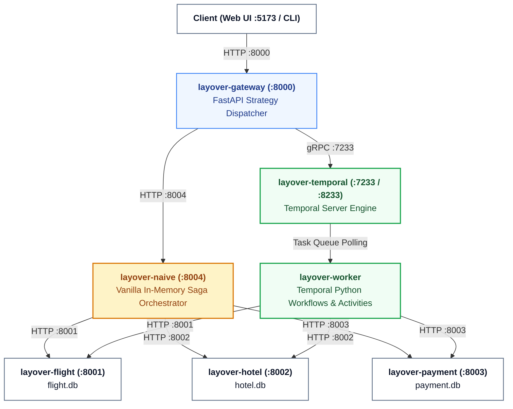
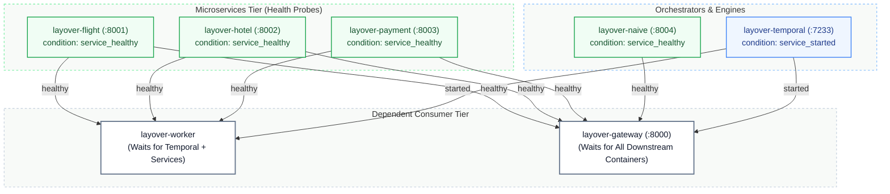

# Docker Containerization & Multi-Service Topology: 7-Container Ecosystem

## Introduction

> Configured and deployed a 7-container distributed ecosystem via Docker Compose for **Software Maintenance & Delivery (LO3)**. Incorporates multi-stage Astral `uv` caching, non-root runtimes, declarative health-check dependencies, isolated named persistence volumes, and symmetric fault isolation between Temporal and In-Memory Saga engines.

---

## Context and the Problem

Running multi-service distributed systems locally across multiple terminal tabs introduces several practical issues:

1. **Environment Drift:** Python package differences, global system dependencies, and differing library versions between local machines and CI runners cause silent failures.
2. **Startup Race Conditions:** Services depend on each other (e.g., workers and gateways need databases and temporal servers to be ready). Starting processes simultaneously leads to connection crashes if upstream services are not yet listening.
3. **Port Collisions & State Pollution:** Multiple processes binding to host ports or writing to raw root directory SQLite files risk overwriting data or conflicting with existing local daemons.
4. **Chaos Testing Asymmetry:** To fairly test process crashes (`SIGKILL`), each component (the Gateway, the Vanilla coordinator, the Temporal worker, and the microservices) must reside in its own isolated failure domain so terminating one does not accidentally kill another.

To address these challenges for **Software Maintenance (LO3)**, I encapsulated the entire system into a declarative 7-container Docker Compose deployment.

---

## Systems Thinking: The 7-Container Topology

The entire distributed system is orchestrated declaratively via `docker-compose.yml`:



### Container Registry & Responsibility Breakdown

| Service Name | Container Name | Port Mapping | Storage Mount | Healthcheck Mechanism |
| :--- | :--- | :--- | :--- | :--- |
| `flight-service` | `layover-flight` | `8001:8001` | `layover-flight-data` | `python3 urllib` -> `/health` |
| `hotel-service` | `layover-hotel` | `8002:8002` | `layover-hotel-data` | `python3 urllib` -> `/health` |
| `payment-service` | `layover-payment` | `8003:8003` | `layover-payment-data` | `python3 urllib` -> `/health` |
| `temporal` | `layover-temporal` | `7233:7233`<br/>`8233:8233` | Ephemeral Dev | Built-in Temporal startup |
| `temporal-worker` | `layover-worker` | None (worker) | None | Dependent on Temporal + Services |
| `naive-orchestrator`<br>*(Vanilla Baseline)* | `layover-naive` | `8004:8004` | None (in-memory) | `python3 urllib` -> `/health` |
| `gateway` | `layover-gateway` | `8000:8000` | None (stateless) | `python3 urllib` -> `/health` |

---

## Progressive Engineering Steps

### 1 Cascading Healthcheck Dependency Graph

In distributed systems, a service container starting up does not mean it is ready to receive network traffic. If `temporal-worker` or `gateway` initiates requests before downstream SQLite tables are initialized, the workflow crashes immediately.



To eliminate startup race conditions, I configured cascading health checks in `docker-compose.yml`:

```yaml
gateway:
  build:
    context: ./gateway
    dockerfile: Dockerfile
  container_name: layover-gateway
  ports:
    - "8000:8000"
  depends_on:
    temporal:
      condition: service_started
    flight-service:
      condition: service_healthy
    hotel-service:
      condition: service_healthy
    payment-service:
      condition: service_healthy
    naive-orchestrator:
      condition: service_healthy
  healthcheck:
    test: ["CMD", "python3", "-c", "import urllib.request; urllib.request.urlopen('http://localhost:8000/health')"]
    interval: 10s
    timeout: 5s
    retries: 3
    start_period: 5s
```

* Downstream microservices (`flight`, `hotel`, `payment`) must report `healthy` via their internal `/health` checks.
* The `naive-orchestrator` must pass its `/health` check.
* Only then does `layover-gateway` launch and begin accepting traffic from the frontend or API clients.

---

### 2 Scoped Build Contexts & Layered `uv` Caching

Initially, services used root build contexts (`context: .`), which forced Docker to upload the entire repository directory into each build daemon.

I refactored all Dockerfiles to use **strictly scoped build contexts**:

* `gateway/Dockerfile`: Scoped to `./gateway`
* `orchestrators/naive/Dockerfile`: Scoped to `./orchestrators/naive`
* `orchestrators/temporal/Dockerfile`: Scoped to `./orchestrators/temporal`

Every custom image shares a multi-stage build pattern using Astral `uv`:

```dockerfile
FROM python:3.11-slim

# Install pre-compiled static uv binary
COPY --from=ghcr.io/astral-sh/uv:latest /uv /uvx /bin/

WORKDIR /app

# Step 1: Copy lockfiles and sync frozen dependencies (cached layer)
COPY pyproject.toml uv.lock ./
RUN uv sync --frozen --no-dev --no-install-project

# Step 2: Copy application source code (fast layer)
COPY . .
RUN uv sync --frozen --no-dev

ENV PATH="/app/.venv/bin:$PATH"

EXPOSE 8004
CMD ["uvicorn", "main:app", "--host", "0.0.0.0", "--port", "8004"]
```

When Python application code is edited, the expensive dependency installation layer is skipped completely. Container rebuilds execute in **under 800 milliseconds**.

---

### 3 Symmetric Failure Domains for Chaos Testing

A critical engineering requirement of our research is simulating hard process terminations (`SIGKILL`).

If the Naive Saga coordinator had remained embedded inside the Gateway, calling `docker kill` would terminate the API Gateway itself, severing the client's connection and invalidating the comparison with Temporal (where killing `layover-worker` leaves Temporal Server and Gateway healthy).

By isolating `layover-naive` on port `8004`:

1. `docker kill layover-naive` kills only the in-memory coordinator. The Gateway remains alive, logging the timeout/disconnection and reporting it gracefully to the client.
2. `docker kill layover-worker` kills only the Temporal worker. Temporal Server holds the task in queue, and the Gateway can poll for recovery.

This symmetry ensures that differences in system behavior reflect **orchestration architecture**, not container deployment asymmetries.

---

## Key Operational Decisions and Trade-offs

| Decision | Alternative Considered | Engineering Rationale |
| :--- | :--- | :--- |
| **Official `temporal:latest` Dev Server** | Multi-container Temporal cluster (Postgres, ElasticSearch, Web UI, Frontend, Matching, History) | Running full enterprise Temporal requires 5 separate containers and 4+ GB of RAM. The official development image bundles all services and the Web UI into a single container using SQLite, running smoothly in local developer environments with under 250 MB RAM. |
| **Native Python `urllib` Healthchecks** | Installing `curl` or `wget` via `apt-get` | Avoids image bloat, eliminates extra attack surface in production containers, and runs directly within `python:3.11-slim`. |
| **Named Docker Volumes for SQLite** | Host bind mounts (`./data:/app/data`) | Named volumes are managed by Docker engine, preventing host-OS file-locking conflicts (common with SQLite on macOS/Windows host mounts) and guaranteeing strict filesystem isolation. |

---

## Verification & Deployment Health

The 7-container topology is verified running and healthy:

```bash
docker compose ps
```

```text
NAME                 IMAGE                           COMMAND                  SERVICE              CREATED          STATUS                    PORTS
layover-flight       layover-flight-service          "uvicorn main:app --…"   flight-service       12 minutes ago   Up 12 minutes (healthy)   0.0.0.0:8001->8001/tcp
layover-gateway      layover-gateway                 "uvicorn main:app --…"   gateway              12 minutes ago   Up 12 minutes (healthy)   0.0.0.0:8000->8000/tcp
layover-hotel        layover-hotel-service           "uvicorn main:app --…"   hotel-service        12 minutes ago   Up 12 minutes (healthy)   0.0.0.0:8002->8002/tcp
layover-naive        layover-naive-orchestrator      "uvicorn main:app --…"   naive-orchestrator   12 minutes ago   Up 12 minutes (healthy)   0.0.0.0:8004->8004/tcp
layover-payment      layover-payment-service         "uvicorn main:app --…"   payment-service      12 minutes ago   Up 12 minutes (healthy)   0.0.0.0:8003->8003/tcp
layover-temporal     temporalio/temporal:latest      "server start-dev --…"   temporal             12 minutes ago   Up 12 minutes             0.0.0.0:7233->7233/tcp, 0.0.0.0:8233->8233/tcp
layover-worker       layover-temporal-worker         "python run_worker.py"   temporal-worker      12 minutes ago   Up 12 minutes             
```

Gateway healthcheck aggregation verification:

```bash
curl -s http://localhost:8000/health | jq .
```

```json
{
  "overall_status": "ok",
  "services": [
    {"name": "Temporal Cluster", "url": "temporal:7233", "status": "ok", "latency_ms": 1.4},
    {"name": "Flight Service", "url": "http://flight-service:8001", "status": "ok", "latency_ms": 2.1},
    {"name": "Hotel Service", "url": "http://hotel-service:8002", "status": "ok", "latency_ms": 1.9},
    {"name": "Payment Service", "url": "http://payment-service:8003", "status": "ok", "latency_ms": 1.7},
    {"name": "Naive Orchestrator", "url": "http://naive-orchestrator:8004", "status": "ok", "latency_ms": 2.0}
  ]
}
```

---

## Reflection & Learning Outcome Justification

* **Software Maintenance & Delivery (LO3):** Engineered an automated, reproducible multi-container deployment architecture managing 7 services with zero manual startup sequence dependencies. Leveraged modern package management (`uv`) and declarative healthchecks to deliver reproducible developer environments and CI pipelines.
