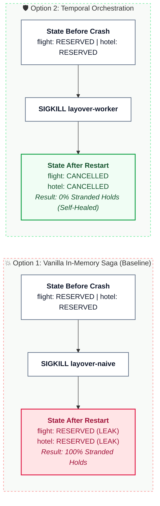
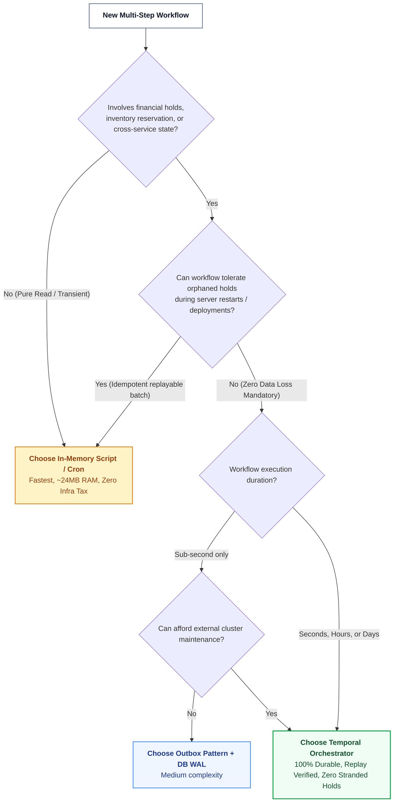

# Architectural Decision Record: Vanilla In-Memory Saga vs. Durable Temporal Orchestration

## Introduction

> Formulated an empirical Architectural Decision Record (ADR) and comparative advisory report for **Professional Standard / Advising (LO4)**. Evaluated Vanilla In-Memory Saga coordination against durable Temporal orchestration across data consistency guarantees, crash-stop fault tolerance, infrastructure overhead, and developer maintenance to provide actionable engineering recommendations for distributed multi-service workflows.

---

## Context and the Problem

Modern cloud-native architectures use the **Database-per-Service** pattern to ensure domain autonomy, independent scalability, and decoupled deployments. In the Layover platform, three autonomous microservices manage distinct business domains:

* **Flight Service (`:8001`):** Manages seat reservations in `flight.db`.
* **Hotel Service (`:8002`):** Manages room holds in `hotel.db`.
* **Payment Service (`:8003`):** Manages customer balances and charges in `payment.db`.

While this pattern provides isolation, it eliminates traditional database-level ACID transactions. A single booking requires updating three physically separated databases across the network. If a downstream service rejects a request (e.g., hotel room sold out, credit card declined) or an orchestrator crashes midway, the system risks entering an inconsistent **«Zombie Hold»** state (e.g., flight seats held indefinitely without payment).

### Why Traditional Alternatives Were Disqualified

During the initial scoping phase ([Cycle 1](../../../cycle-1.md)), two classic distributed transaction approaches were evaluated and rejected:

1. **Two-Phase Commit (2PC):** Disqualified due to synchronous blocking, coordinator single-point-of-failure, database engine coupling, and extreme latency penalties across HTTP microservice boundaries.
2. **Choreographed Event Sagas (Kafka / RabbitMQ):** Disqualified for simple request-response workflows due to operational complexity, cyclic dependency risks, and poor end-to-end trace visibility compared to Orchestrated Sagas.

### The Research Question

> *To what extent does a durable workflow orchestrator ([Temporal.io](https://temporal.io)) justify its infrastructure overhead compared to a lightweight, in-memory procedural Saga script under controlled partial and process-crash failures?*

---

## Systems Thinking & Empirical Testbed

To rigorously compare both paradigms against the exact same microservices (`flight.db`, `hotel.db`, `payment.db`), I implemented and benchmarked two architectural options:

* **Option 1: Vanilla In-Memory Saga (`layover-naive` on `:8004`):** Standalone FastAPI coordinator. Executes forward HTTP requests sequentially, tracking compensations in a volatile Python LIFO stack in RAM.
* **Option 2: Durable Temporal Orchestration (`temporal` + `layover-worker` on `:7233`):** Event-sourced state machine using the Temporal Python SDK. Every workflow state transition is durably appended to Temporal Server's SQLite event store before activity execution.

### Empirical Chaos Methodology (`SIGKILL` Benchmark)

Both engines were verified across a 120-test automated suite (including `httpx.MockTransport`, `WorkflowEnvironment` time-skipping, and Replayer determinism tests). To test crash recovery, an HTTP synchronization barrier paused execution during active reservations immediately before payment, and a `SIGKILL` (`docker kill`) was issued against the active coordinator:

---

## Key Decisions & Architectural Decision Record (ADR)

### Comparative Benchmark Breakdown

1. **Normal Business Failures (Hotel 422, Payment 400):**
   * *Option 1: Vanilla In-Memory Saga (Baseline):* **100% Consistent** — LIFO compensation stack executes sequentially to completion.
   * *Option 2: Temporal Orchestration:* **100% Consistent** — Workflow exception triggers compensating activity handlers.
   * *Engineering Rationale:* Both architectures succeed equally when the coordinator remains alive in memory; vanilla saga is sufficient if process crashes never occur.

2. **Crash-Stop Resilience (`kill -9` During Active Holds):**
   * *Option 1: Vanilla In-Memory Saga (Baseline):* **0% Resilient** (100% Orphaned Holds) — coordinator stack in RAM is completely wiped.
   * *Option 2: Temporal Orchestration:* **100% Resilient** (0% Orphaned Holds) — event history is durably committed before activity execution.
   * *Engineering Rationale:* Temporal eliminates split-brain and zombie reservations by decoupling state storage from the executing worker process.

3. **Recovery Behavior Under Infrastructure Failure:**
   * *Option 1: Vanilla In-Memory Saga (Baseline):* **Manual Intervention** — requires manual operator triage, log grepping, and custom SQL cleanup scripts.
   * *Option 2: Temporal Orchestration:* **Zero-Touch Self-Healing** — worker reconnects upon reboot, replays history, and recovers in < 2 seconds.
   * *Engineering Rationale:* Verified deterministically via automated integration benchmarks (`test_process_crashes.py`).

4. **Process & Container Density:**
   * *Option 1: Vanilla In-Memory Saga (Baseline):* **1 process** (`layover-naive` FastAPI container on port 8004).
   * *Option 2: Temporal Orchestration:* **2 processes minimum** (`temporal` Go development server on port 7233 + `layover-worker` Python consumer).
   * *Engineering Rationale:* Temporal separates cluster state management from task worker execution, requiring multi-process orchestration.

5. **Idle Resource Consumption (RAM):**
   * *Option 1: Vanilla In-Memory Saga (Baseline):* **~24 MB RAM** — lightweight single-process footprint.
   * *Option 2: Temporal Orchestration:* **~210 MB – 260 MB RAM** — combined Go server runtime and Python worker event loop.
   * *Engineering Rationale:* The «infrastructure tax» of durable orchestration: a ~10x increase in idle memory to guarantee complete fault tolerance.

6. **Coordinator Code Complexity:**
   * *Option 1: Vanilla In-Memory Saga (Baseline):* **~140 lines of boilerplate** — explicit LIFO rollback arrays, manual try/except blocks, custom HTTP status handling.
   * *Option 2: Temporal Orchestration:* **~45 lines of workflow code** — declarative activity calls with framework-managed timeouts, retries, and backoffs.
   * *Engineering Rationale:* Business workflow logic in Temporal remains clean and readable, offloading distributed systems mechanics to the platform.

7. **Testing Overhead & Complexity:**
   * *Option 1: Vanilla In-Memory Saga (Baseline):* Simple HTTP mock transport (`httpx.MockTransport`) testing standard request/response semantics.
   * *Option 2: Temporal Orchestration:* Requires `WorkflowEnvironment` time-skipping mocks, activity stubs, and strict Replayer verification against JSON event logs.
   * *Engineering Rationale:* Temporal introduces a steeper developer learning curve around workflow determinism and SDK testing fixtures.

### The Core Trade-off: The «Infrastructure Tax»

The empirical data shows that **fault tolerance incurs an infrastructure tax**: Temporal requires ~10x more idle RAM (~240MB vs ~24MB) and an external coordinator service.

However, in transactional domains involving real assets (seats, rooms, money), **the business cost of manual data reconciliation is significantly higher than the cost of running an additional lightweight container**. A single orphaned airline hold or double credit card charge generates customer support tickets, financial chargebacks, and manual engineering triage that far exceed the cost of running a 250MB container cluster.

### The Decision: Adopt Temporal for Transactional Workflows

For the Layover core booking pipeline, **Option 2 (Temporal Workflow Orchestration) is officially recommended and accepted** as the primary orchestration engine.

While the Vanilla In-Memory Saga is lightweight, its fundamental vulnerability to process crashes (volatile RAM stack destruction leading to permanent inventory leaks) makes it unsuitable for production environments where financial consistency is required.

### Advisory Decision Tree: When to Choose What

* **Rule of Thumb (Lightweight Scripting):** Choose in-memory scripting when workflows are read-only, short-lived (<2s), idempotent (client can safely retry), or running under extreme memory constraints (<128MB RAM).
* **Rule of Thumb (Temporal Orchestration):** Choose Temporal when workflows involve multi-party financial holds, long durations (hours/days), zero tolerance for stranded inventory, or compliance audit requirements.

---

## Reflection & Learning Outcome Justification

* **Professional Standard / Advising (LO4):** Formulated an evidence-based Architectural Decision Record grounded in measured reliability metrics, memory profiling, and chaos test data rather than marketing claims. Provided an actionable decision framework guiding development teams on when to accept or avoid durable workflow engine complexity.

### Proposed Scope Extension (For Alignment in Cycle 5)

Following peer feedback during the Knowledge Sharing session ([LO5 Reflection](../../lo5/peer-knowledge-sharing/lo5-peer-feedback-and-reflection.md)), I formulated two potential research extensions to discuss with teachers during the upcoming consultation, balancing extra depth against the PDP time budget:

1. **Continuous Resource & Metric Profiling:** Integrating Prometheus and Grafana to monitor activity latency, task queue backlog, and worker poll delays under sustained operation.
2. **High-Concurrency Load Benchmarking:** Scaling from single-request chaos benchmarks to 100 concurrent booking requests to measure SQLite lock contention and worker queue throughput.
