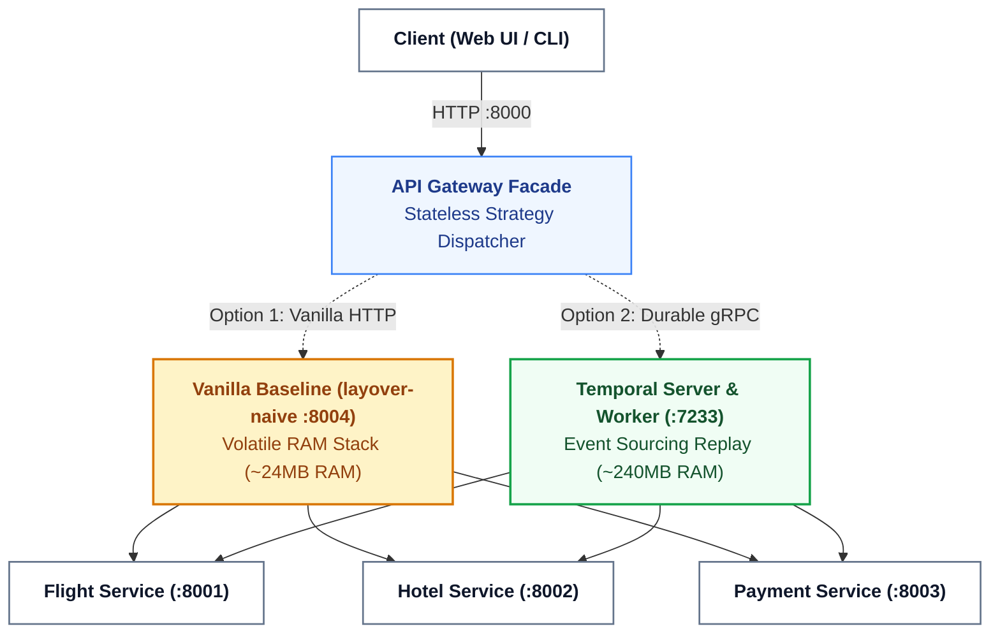
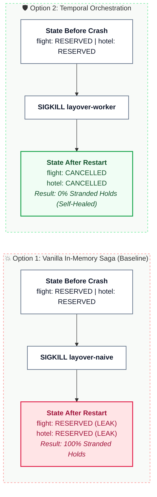
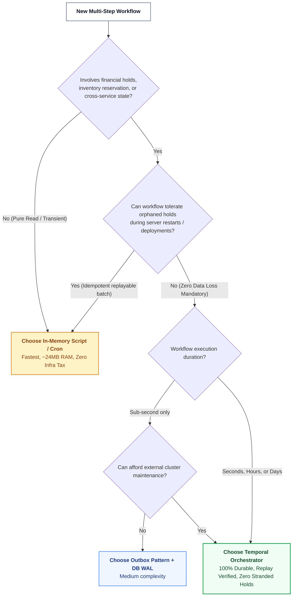

# Architectural Decision Record: Vanilla In-Memory Saga vs. Durable Temporal Orchestration

## Introduction

> Formulated an empirical Architectural Decision Record (ADR) and comparative advisory report for **Professional Standard / Advising (LO4)**. Evaluated Vanilla In-Memory Saga coordination against durable Temporal orchestration across data consistency guarantees, crash-stop fault tolerance, infrastructure overhead, and developer maintenance to provide actionable engineering recommendations for distributed multi-service workflows.

---

## Context and the Problem

Modern cloud-native architectures use the **Database-per-Service** pattern to ensure domain autonomy, independent scalability, and decoupled deployments. In the Layover platform, three autonomous microservices manage distinct business domains:

* **Flight Service (`:8001`):** Manages seat reservations in `flight.db`.
* **Hotel Service (`:8002`):** Manages room holds in `hotel.db`.
* **Payment Service (`:8003`):** Manages customer balances and charges in `payment.db`.

While this pattern provides isolation, it eliminates traditional database-level ACID transactions. A single booking requires updating three physically separated databases across the network. If a downstream service rejects a request (e.g., hotel room sold out, credit card declined) or an orchestrator crashes midway, the system risks entering an inconsistent **«Zombie Hold»** state (e.g., flight seats held indefinitely without payment).

### Why Traditional Alternatives Were Disqualified

During the initial scoping phase ([Cycle 1](../../../cycle-1.md)), two classic distributed transaction approaches were evaluated and rejected:

1. **Two-Phase Commit (2PC):** Disqualified due to synchronous blocking, coordinator single-point-of-failure, database engine coupling, and extreme latency penalties across HTTP microservice boundaries.
2. **Choreographed Event Sagas (Kafka / RabbitMQ):** Disqualified for simple request-response workflows due to operational complexity, cyclic dependency risks, and poor end-to-end trace visibility compared to Orchestrated Sagas.

### The Research Question

> *To what extent does a durable workflow orchestrator ([Temporal.io](https://temporal.io)) justify its infrastructure overhead compared to a lightweight, in-memory procedural Saga script under controlled partial and process-crash failures?*

---

## Systems Thinking: How It Fits the Project

The comparison evaluates two distinct architectural paradigms interacting with the exact same underlying microservices:

### Evaluation Dimensions (Quality Criteria from PDP)

In accordance with [docs/pdp.md](../../../pdp.md), the architectural options were evaluated across four empirical dimensions:

1. **Data Consistency & Orphaned Holds:** Does every transaction settle into a terminal state (`CONFIRMED` or `COMPENSATED`), or do partial records stay stranded in `RESERVED`?
2. **Recovery Complexity (RTO/RPO):** When a coordinator process is killed mid-transaction (`SIGKILL`), does the system recover automatically or require manual database scripts?
3. **Infrastructure Footprint («The Infrastructure Tax»):** Process count, idle RAM utilization, and external dependencies.
4. **Developer Ergonomics & Maintenance:** Code maintainability, state machine boilerplate, and workflow testability.

---

## Progressive Engineering Steps

The comparative study was conducted across four progressive phases:

### 1 Vanilla In-Memory Baseline Implementation (Option 1)

Implemented `orchestrators/naive/` as a standalone FastAPI service. It executes forward HTTP requests sequentially (`Flight -> Hotel -> Payment`) while pushing compensating mirrors onto an in-memory Python LIFO stack. On error, it unwinds the stack in reverse order.

### 2 Durable Temporal Orchestrator Implementation (Option 2)

Implemented `orchestrators/temporal/` using the Temporal Python SDK. Workflows are deterministic state machines that schedule activities. State transitions are durably recorded in Temporal Server's append-only Event History.

### 3 Automated Quality & Replay Testing Harness

Built a 120-test test suite covering both engines:

* Vanilla orchestrator verified using `httpx.MockTransport` across 18 test cases.
* Temporal workflow verified using `WorkflowEnvironment.start_time_skipping()` and native `Replayer` determinism tests across 6 test cases.

### 4 Deterministic Chaos Benchmarking (SIGKILL Experiment)

Configured a test harness with an HTTP synchronization barrier (`payment_barrier.py`) that pauses execution right after reservations succeed, immediately before payment:

* Killed `layover-naive` via `SIGKILL`.
* Killed `layover-worker` via `SIGKILL`.
* Inspected SQLite databases across all containers before and after restart.

---

## Key Decisions & Architectural Decision Record (ADR)

### Comparative Benchmark Matrix

| Evaluation Criteria | Option 1: Vanilla In-Memory Saga (Baseline) *(codebase: layover-naive)* | Option 2: Temporal Orchestration | Engineering Justification |
| :--- | :--- | :--- | :--- |
| **Normal Business Failures** (Hotel 422, Payment 400) | **100% Consistent** (LIFO rollbacks succeed) | **100% Consistent** (LIFO rollbacks succeed) | Both engines cleanly trigger reverse compensations when the coordinator remains alive in RAM. |
| **Crash-Stop Resilience** (`kill -9` during active holds) | **0% Resilient** (100% Orphaned Holds) | **100% Resilient** (0% Orphaned Holds) | Vanilla stack in RAM is destroyed. Temporal worker restart replays event history and completes rollbacks. |
| **Recovery Behavior** | **Manual Intervention** Requires custom SQL cleanup scripts. | **Zero-Touch Self-Healing** Recovers in < 2 seconds upon worker startup. | Verified via `test_process_crashes.py` using SQLite database snapshots. |
| **Process / Container Count** | **1 process** (`layover-naive` on `:8004`) | **2 processes minimum** (`temporal` server + `layover-worker`) | Temporal decouples event persistence from activity workers. |
| **Idle Memory Footprint** | **~24 MB RAM** | **~210 MB – 260 MB RAM** (combined Go server + Python worker) | Measured via Docker container stats. |
| **Code Complexity (Coordinator)** | **~140 lines of boilerplate** (manual LIFO stack, custom error catching) | **~45 lines of workflow code** (clean declarative activity execution) | Temporal manages retries, exponential backoffs, and timeout policies natively. |
| **Testing Overhead** | Simple HTTP mock transport (`httpx.MockTransport`) | Requires `WorkflowEnvironment` & Replayer testing | Temporal requires understanding determinism constraints and SDK test environments. |

### The Core Trade-off: The «Infrastructure Tax»

The empirical data shows that **fault tolerance incurs an infrastructure tax**: Temporal requires ~10x more idle RAM (~240MB vs ~24MB) and an external coordinator service.

However, in transactional domains involving real assets (seats, rooms, money), **the business cost of manual data reconciliation is significantly higher than the cost of running an additional lightweight container**. A single orphaned airline hold or double credit card charge generates customer support tickets, financial chargebacks, and manual engineering triage that far exceed the cost of running a 250MB container cluster.

### The Decision: Adopt Temporal for Transactional Workflows

For the Layover core booking pipeline, **Option 2 (Temporal Workflow Orchestration) is officially recommended and accepted** as the primary orchestration engine.

While the Vanilla In-Memory Saga is lightweight, its fundamental vulnerability to process crashes (volatile RAM stack destruction leading to permanent inventory leaks) makes it unsuitable for production environments where financial consistency is required.

### Advisory Decision Tree: When to Choose What

#### Choose In-Memory / Lightweight Scripting When

* The workflow is read-only or informational (e.g., aggregating user profile data, calculating report statistics).
* The workflow is short-lived (<2s) and completely idempotent: if a failure strikes, the client can simply press «Retry» without leaving half-held real-world assets.
* The team operates under extreme memory constraints (e.g., micro-edge IoT devices with <128MB total RAM).

#### Choose Temporal Orchestration When

* The workflow involves multi-party commitments, payments, or third-party APIs that cannot be rolled back with a single local database rollback.
* Workflows span long durations (human-in-the-loop approvals, 24-hour check-in reminders).
* Regulatory or compliance requirements demand a verifiable, append-only audit trail (Event History) for every execution.

---

## Reflection & Learning Outcome Justification

* **Professional Standard / Advising (LO4):** Formulated an evidence-based Architectural Decision Record grounded in measured reliability metrics, memory profiling, and chaos test data rather than marketing claims. Provided an actionable decision framework guiding development teams on when to accept or avoid durable workflow engine complexity.

### Phase 2 Roadmap: Extended Cycle 5 Research

Following peer feedback during the Knowledge Sharing session ([LO5 Reflection](../../lo5/peer-knowledge-sharing/lo5-peer-feedback-and-reflection.md)), this decision will be further evaluated during Phase 2 of Cycle 5:

1. **Continuous Resource & Metric Profiling:** Integrating Prometheus and Grafana to monitor activity latency, task queue backlog, and worker poll delays under sustained operation.
2. **High-Concurrency Load Benchmarking:** Scaling from single-request chaos benchmarks to 100 concurrent booking requests to measure SQLite lock contention and worker queue throughput.
