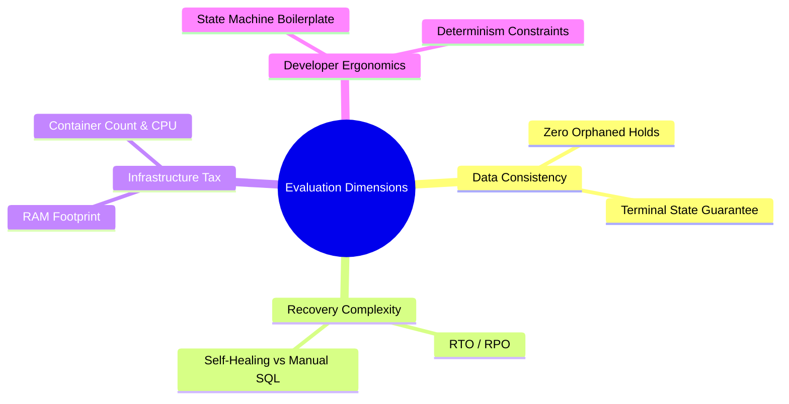
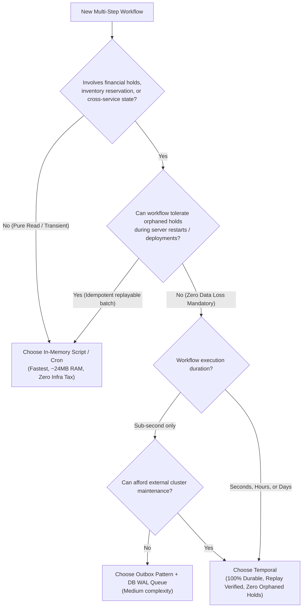
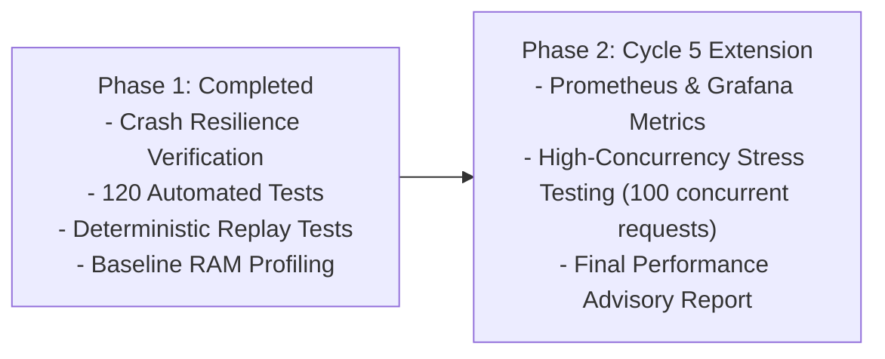

# Architectural Decision Record: In-Memory Saga vs. Durable Temporal Orchestration

> **Document Type:** Portfolio Evidence & Architectural Advisory Report  
> **Learning Outcome:** LO4 – Professional Standard (Advising)  
> **Status:** `ACCEPTED (INTERIM CHECKPOINT)` — Phase 1 Reliability & Consistency Evaluation  
> **Date:** November 14, 2026  
> **Author:** Ivan Bodnar  
> **Target Audience:** Engineering Leads, System Architects, Portfolio Assessors  
> **Context:** Distributed multi-service booking workflows under partial and crash-stop failures  
> **Related Documents:** [PDP](../../pdp.md) | [Cycle 1: Research](../../cycle-1.md) | [Cycle 4: Baseline](../../cycle-4.md) | [LO2: Quality v2](../lo2/contract-and-integration-testing/lo2-contract-and-integration-testing-v2.md) | [LO5: Peer Reflection](../lo5/peer-knowledge-sharing/lo5-peer-feedback-and-reflection.md)

---

## 1. Context & Problem Statement

Modern cloud-native architectures mandate the **Database-per-Service** pattern to ensure domain autonomy, independent scalability, and decoupled deployments. In the Layover travel booking platform, three autonomous microservices manage distinct business domains:
* **Flight Service (`:8001`):** Manages seat reservations and status transitions in `flight.db`.
* **Hotel Service (`:8002`):** Manages room holds and status transitions in `hotel.db`.
* **Payment Service (`:8003`):** Manages customer accounts, balances, and charges in `payment.db`.

While this pattern provides isolation, it eliminates traditional database-level ACID transactions. A single user booking requires updating three physically separated databases across the network. If a downstream service rejects a request (e.g., hotel room sold out, credit card declined) or an orchestrator crashes midway, the system risks entering an inconsistent **«Zombie Hold»** state (e.g., flight seats held indefinitely without payment).

### Why Traditional Alternatives Were Disqualified
During the initial scoping phase ([Cycle 1](../../cycle-1.md)), two classic distributed transaction approaches were evaluated and rejected:
1. **Two-Phase Commit (2PC):** Disqualified due to synchronous blocking, coordinator single-point-of-failure, database engine coupling, and extreme latency penalties across HTTP microservice boundaries.
2. **Choreographed Event Sagas (Kafka / RabbitMQ):** Disqualified for simple request-response workflows due to excessive operational complexity, cyclic dependency risks, and poor end-to-end trace visibility compared to Orchestrated Sagas.

### The Research Question
> *To what extent does a durable workflow orchestrator ([Temporal.io](https://temporal.io)) justify its infrastructure overhead compared to a lightweight, in-memory procedural Saga script under controlled partial and process-crash failures?*

---

## 2. Decision Drivers & Evaluation Dimensions

In accordance with [docs/pdp.md](../../pdp.md), the architectural options were evaluated across four empirical dimensions:

1. **Data Consistency & Orphaned Holds:** The system must guarantee that every booking settles into a terminal state (`CONFIRMED` or `COMPENSATED`). No temporary reservation may remain in `RESERVED` status.
2. **Recovery Complexity (Mean Time to Recovery):** When an orchestrator process is killed mid-transaction (`SIGKILL`), does the system self-heal automatically, or does it require manual database remediation?
3. **Infrastructure Footprint («The Infrastructure Tax»):** Process count, idle memory utilization, CPU baseline, and external dependencies.
4. **Developer Ergonomics & Maintenance:** Lines of code required to maintain rollback logic, mental overhead of state handling, and workflow testing feasibility.

---

## 3. Considered Options

### Option 1: In-Memory Naive Saga (`layover-naive`)
A lightweight, standalone Python service (FastAPI) executing forward HTTP requests sequentially (`Flight -> Hotel -> Payment`) while maintaining an in-memory LIFO compensation stack in a `try/except` block.
* **Forward Path:** `POST /reserve` $\rightarrow$ `POST /reserve` $\rightarrow$ `POST /charge` $\rightarrow$ `POST /confirm`.
* **Compensating Path:** On error, pops previously completed actions from the Python RAM list and executes them in reverse order (`cancel_hotel`, `cancel_flight`).

### Option 2: Durable Workflow Orchestration (Temporal)
A workflow orchestrated by Temporal's Python SDK (`temporalio`), backed by a durable Temporal cluster engine (`:7233`) and an asynchronous Python worker (`layover-worker`).
* **Workflow Definition:** Pure deterministic state machine decorating compensations as activities.
* **Durability:** Every state transition, activity schedule, and activity completion is committed to an append-only Event History.

---

## 4. Empirical Evaluation & Findings (Phase 1 Baseline)

The two approaches were subjected to the exhaustive 120-test automated suite and live Chaos Testing ([LO2 Evidence](../lo2/contract-and-integration-testing/lo2-contract-and-integration-testing-v2.md)). The empirical results are summarized below:

| Evaluation Criteria | Option 1: In-Memory Naive Saga | Option 2: Temporal Orchestration | Engineering Justification & Evidence |
| :--- | :--- | :--- | :--- |
| **Normal Business Failures** (e.g. Hotel 422, Payment 400) | **100% Consistent** (LIFO rollbacks succeed) | **100% Consistent** (LIFO rollbacks succeed) | Both engines successfully execute reverse compensations when the coordinator remains alive in RAM. |
| **Crash-Stop Resilience** (`kill -9` during active holds) | **0% Resilient** (100% Orphaned Holds) | **100% Resilient** (0% Orphaned Holds) | Naive stack is completely destroyed in RAM upon SIGKILL. Temporal worker restart replays event history and completes rollbacks. |
| **Recovery Behavior** | **Manual Intervention Required** Requires custom SQL cleanup scripts. | **Zero-Touch Self-Healing** Recovers in < 2 seconds upon worker startup. | Tested via `gateway/tests/integration/test_process_crashes.py` with deterministic HTTP barrier synchronization. |
| **Process / Container Count** | **1 process** (`layover-naive` on `:8004`) | **2 processes minimum** (`temporal` server + `layover-worker`) | Temporal decouples event storage from compute workers. |
| **Idle Memory Footprint** | **~24 MB RAM** | **~210 MB – 260 MB RAM** (combined Go server + Python worker) | Verified via Docker container inspection. |
| **Code Complexity (Coordinator)** | **~140 lines of boilerplate** (manual LIFO stack, custom error catching) | **~45 lines of workflow code** (clean declarative activity execution) | Temporal handles retries, exponential backoffs, and timeout policies out of the box. |
| **Testing Overhead** | Simple HTTP mock transport (`httpx.MockTransport`) | Requires `temporalio.testing.WorkflowEnvironment` & Replayer | Temporal provides time-skipping test environments and formal Replay determinism verification. |

### The Core Finding: The «Infrastructure Tax»
The empirical data proves that **fault tolerance incurs a measurable infrastructure tax**: Temporal requires ~10x more idle RAM (~240MB vs ~24MB) and an external coordinator service. 

However, in transactional domains involving real assets (airline seats, hotel rooms, money), **the business cost of data inconsistency dwarfs the infrastructure tax**. A single orphaned airline hold or double credit card charge generates customer support tickets, financial chargebacks, and manual engineering triage that far exceed the cost of running a 250MB container cluster.

---

## 5. Architectural Decision & Advisory Matrix

### The Interim Decision: Adopt Temporal for Transactional Workflows
For the Layover core booking pipeline, **Option 2 (Temporal Workflow Orchestration) is officially recommended and accepted** as the primary orchestration engine. 

While the In-Memory Saga is lightweight, its fundamental vulnerability to process crashes (volatile RAM stack destruction leading to permanent inventory leaks) makes it unsuitable for production environments where financial consistency is required.

### When to Choose What (Advisory Decision Tree)

#### Choose In-Memory / Lightweight Scripting When:
* The workflow is read-only or informational (e.g., aggregating user profile data, calculating report statistics).
* The workflow is short-lived (<2s) and completely idempotent: if a failure strikes, the client can simply press «Retry» without leaving half-held real-world assets.
* The team operates under extreme memory constraints (e.g., micro-edge IoT devices with <128MB total RAM).

#### Choose Temporal Orchestration When:
* The workflow involves multi-party commitments, payments, or third-party APIs that cannot be rolled back with a single local database rollback.
* Workflows span long durations (human-in-the-loop approvals, 24-hour check-in reminders).
* Regulatory or compliance requirements demand a cryptographically verifiable, append-only audit trail (Event History) for every execution.

---

## 6. Phase 2 Roadmap: Extended Cycle 5 Research

This document represents the **Phase 1 Interim Milestone** of the comparative research. Following constructive peer feedback during the Knowledge Sharing session ([LO5 Reflection](../lo5/peer-knowledge-sharing/lo5-peer-feedback-and-reflection.md)), the project will proceed into **Phase 2 (Extended Cycle 5)** prior to the final defense:

1. **Continuous Resource & Metric Profiling (Grafana / Prometheus):**
   * Integrate Prometheus metrics from Temporal Server (`:9090`) to measure activity latency, task queue backlog, and worker poll delays under sustained operation.
2. **High-Concurrency Load Benchmarking:**
   * Scale test execution from single-request chaos benchmarks to **100 concurrent booking requests**.
   * Measure SQLite lock contention under parallel writes and evaluate how Temporal's task queues buffer load spikes compared to naive HTTP requests.
3. **Final Comprehensive Comparison Report:**
   * Synthesize Phase 1 reliability metrics with Phase 2 throughput and resource telemetry to provide a publication-ready comparative study.

---

## 7. Evidence Cross-References

* **Initial Scoping & Hypotheses:** [`docs/pdp.md`](../../pdp.md) | [`docs/cycle-1.md`](../../cycle-1.md)
* **Baseline Naive Implementation:** [`docs/cycle-4.md`](../../cycle-4.md)
* **Automated Quality Suite & Chaos Tests:** [`docs/evidences/lo2/contract-and-integration-testing/lo2-contract-and-integration-testing-v2.md`](../lo2/contract-and-integration-testing/lo2-contract-and-integration-testing-v2.md)
* **Peer Feedback & Bloom Evaluation:** [`docs/evidences/lo5/peer-knowledge-sharing/lo5-peer-feedback-and-reflection.md`](../lo5/peer-knowledge-sharing/lo5-peer-feedback-and-reflection.md)
* **Database Verification Script:** [`scripts/check_integrity.py`](../../../scripts/check_integrity.py)
