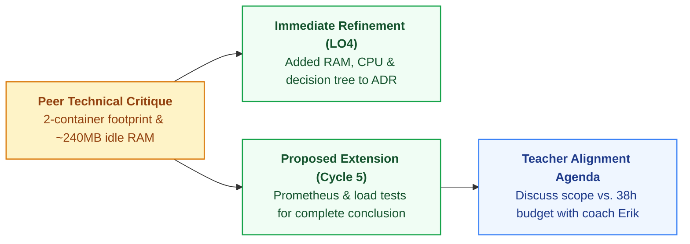

# Peer Knowledge Sharing & Technical Feedback Reflection

## Introduction

> Presented the distributed booking architecture during the **Knowledge Sharing & Peer Matchmaking Session (Nov 9, 2026)** for **Personal Leadership (LO5)**. Evaluated constructive peer critiques regarding multi-container overhead versus lightweight script baselines, translating feedback into immediate ADR refinements and evaluating a proposed scope extension to align with educators for Cycle 5.

---

## Session Context & Peer Group

To validate architectural choices under peer scrutiny, I prepared a 3-minute video pitch and a live system demonstration for fellow software engineering students:

* **Presentation Focus:** Distributed transaction failures under Database-per-Service isolation, comparing in-memory procedural LIFO rollbacks against durable Temporal event-sourcing.
* **Live Demo:** Triggering automated rollbacks on payment failure and demonstrating inventory leaks via `SIGKILL` during active holds.
* **Peer Review Group:** **Ernestas Bogdan**, **Vladyslav Luzianin**, and **Martin Simeonov** (fellow backend & distributed systems students).

---

## Peer Feedback & Architectural Insights

The peer review session provided clear validation along with a critical inquiry regarding operational overhead:

* **What Peers Validated:**
  * **First-Principles Implementation:** Commended building the entire topology (SQLite CAS state machines, custom compensation endpoints, Docker Compose harness) from scratch rather than using template scaffolding.
  * **Visual Observability:** Emphasized the value of the React state-machine dashboard in making distributed failure modes instantly understandable.
  * **Database Autonomy:** Strongly agreed with strict physical isolation (`flight.db`, `hotel.db`, `payment.db`), confirming that shared-database shortcuts defeat the study of partial failures.
* **Critical Critique & Inquiry (The Infrastructure Tax):**
  * *«Temporal always takes 2 services running (server + worker) and ~240MB RAM, whereas the vanilla baseline orchestrator is just a single Python process using ~24MB.»*
  * Peers questioned whether Temporal's durability overhead is justified for small or low-volume services.
  * Constructive suggestion: measure exact resource footprints (RAM, CPU, queue latency) and define clear rules on when *not* to use Temporal.

---

## Addressing Feedback & Potential Scope Extension for Cycle 5

Engineering leadership means listening to technical critiques, making immediate refinements where possible, and evaluating potential scope changes pragmatically rather than blindly accumulating scope creep. Based on the peer review, I structured my response across three clear steps:

1. **Immediate ADR Refinements (Delivered in LO4):** Rather than evaluating Temporal solely on crash recovery, I immediately incorporated the ~10x memory difference (~24MB vs ~240MB RAM) and multi-process overhead into the comparison report ([LO4 ADR](../../lo4/adr-orchestrator-selection/lo4-architectural-decision-record.md)), along with the «When to Choose What» advisory decision tree.
2. **Formulating a Potential Scope Extension for Cycle 5:** To make the final comparative conclusion fully comprehensive, I evaluated whether to slightly expand the upcoming final cycle with lightweight telemetry (Prometheus/Grafana) and a concurrency benchmark to observe task queue backlogs under load.
3. **Aligning Scope with Teachers & Coach (Erik):** Because strict time management (~38-hour total budget in [pdp.md](../../../pdp.md)) is a core requirement of Personal Leadership, I decided not to implement this extension unilaterally. Instead, I placed this proposed scope extension on the agenda for the upcoming consultation with my coach (Erik) to evaluate if the extra depth justifies the remaining time budget.

---

## Reflection & Personal Leadership (LO5)

### What Went Well

* **Clear Technical Communication:** Successfully explained distributed transaction trade-offs (Sagas, compensations, 2PC, event sourcing) using the live UI to make abstract concepts tangible.
* **Overcoming Constraints with Resilience:** When illness prevented live voice recording, I scripted the technical narrative and utilized an AI voiceover tool to deliver the pitch video on schedule without blocking the group milestone.
* **Active Feedback Integration:** Welcomed constructive criticism regarding container bloat and turned it into an empirical evaluation dimension in LO4 rather than defending the initial design.

### Areas for Improvement

* **Audience Calibration:** In the initial discussion, diving straight into Temporal SDK replay determinism was too low-level for peers unfamiliar with workflow engines. Leading with the visual state dashboard proved far more engaging.
* **Demo Time Management:** Running through multiple chaos scenarios and database queries slightly exceeded the time limit. For future presentations, I will stick strictly to the structured runbook ([`docs/demo-scenarios.md`](../../../demo-scenarios.md)) to stay within 5 minutes.

> **Personal Leadership (LO5) Justification:** Proactively organized and delivered technical deliverables under health and time constraints, facilitated structured peer review, incorporated critical observations into the architectural advice, and balanced proposed scope expansions against PDP time constraints through teacher alignment.
