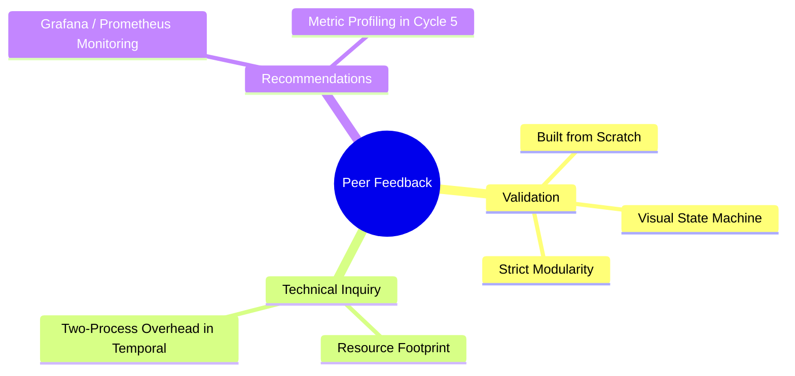
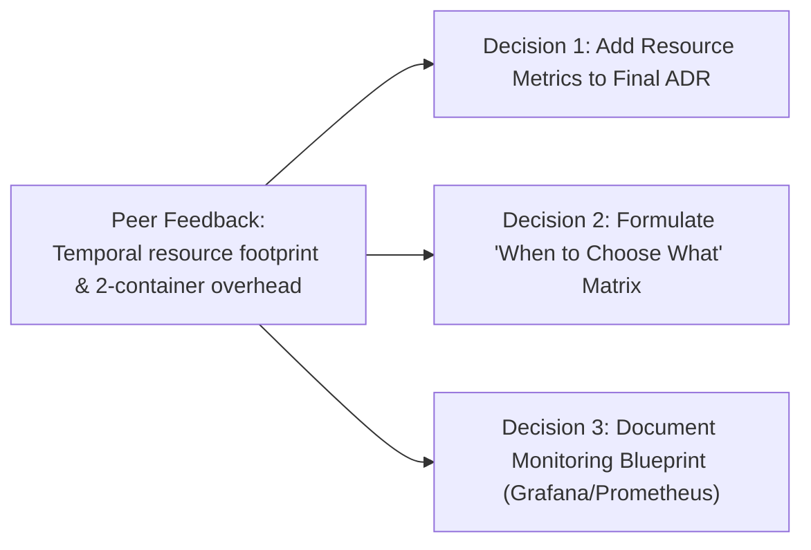

# Peer Knowledge Sharing & Technical Feedback Reflection (LO5: Personal Leadership)

> **Document Type:** Portfolio Evidence & Logbook Reflection  
> **Learning Outcome:** LO5 – Personal Leadership  
> **Course / Semester:** Fall 2026 Complex Software Systems (Fontys University of Applied Sciences)  
> **Target Date:** Monday, November 9, 2026  
> **Participants:** Ivan Bodnar, Ernestas Bogdan, Vladyslav Luzianin, Martin Simeonov  
> **Related Cycles:** [Cycle 4: In-Memory Saga Baseline & React UI](../../cycle-4.md) $\rightarrow$ [Cycle 5: Comparison & Advisory Report](../../pdp.md#cycle-details)

---

## 1. Introduction & Academic Objective

In accordance with the **Personal Leadership (LO5)** criteria, software engineers must demonstrate proactive self-direction, effective stakeholder and peer communication, time and scope governance, and the ability to solicit, critically analyze, and integrate feedback to steer architectural research.

This document serves as the formal reflection and empirical evidence for the **Knowledge Sharing & Peer Matchmaking Session** held on Monday, November 9, 2026. It documents:

1. The preparation and delivery of the 3-minute project pitch video and live system demonstration.
2. The peer review feedback gathered from fellow software engineering students specializing in distributed architectures.
3. A deep engineering reflection using **Bloom's Taxonomy (Level 5: Evaluation)** on the operational trade-offs raised by peers.
4. Concrete project steering decisions incorporated into the final research cycle ([Cycle 5](../../pdp.md#cycle-details)).

---

## 2. Session Context & Execution

### 2.1 Format & Preparation

Prior to the session, I prepared and published a structured 3-minute technical pitch video titled `Ivan_Bodnar_Layover_Microservices_Sagas.mp4`, adhering to the strict curriculum format:

* **The Problem:** Distributed failure modes under Database-per-Service isolation (inability of single-database ACID rollbacks to span microservice boundaries; latency and locking penalties of 2-Phase Commit).
* **The Research Goal:** Empirical comparison of in-memory procedural LIFO rollbacks (`try/except` in RAM) versus durable, event-sourced orchestration ([Temporal.io](https://temporal.io)).
* **Technical Decisions:** 7-container Docker Compose ecosystem, independent FastAPI services with isolated SQLite databases, stateless API Gateway with Strategy pattern, and a React 19 + TypeScript dashboard.
* **Live Demo & Evidence:** Demonstrating LIFO rollbacks on `Payment decline` ($2,500 > $1,000 balance) and hard process crash benchmarking (`SIGKILL` during `Chaos pause 4s`) showing orphaned holds in `flight.db`.
* **Challenges & Matchmaking Hook:** Inviting peers interested in distributed reliability, event-driven systems, and workflow engines.

> [!NOTE]
> **Personal Leadership Under Constraint:** On the night before the presentation, I experienced severe throat illness and voice loss. Rather than missing the milestone or submitting an unvoiced video, I proactively adapted: I scripted a concise, conversational 260-word English presentation and utilized AI-driven narration via **Hyperframes**, styled exactly to match the clean, light-mode palette of the Layover dashboard. The deliverable was submitted on time to the SharePoint repository prior to the 10:00 AM deadline.

### 2.2 Peer Matchmaking & Group Composition

During the initial 20-minute matchmaking phase, I presented my project card:

* **Topic:** Distributed Transactions, Saga Pattern, and Fault Tolerance.
* **Stack:** Python (FastAPI), Temporal.io, Docker Compose, React 19, SQLite.

I formed a dedicated peer review group with three students whose projects also focus on modular backend systems and distributed services:

* **Ernestas Bogdan**
* **Vladyslav Luzianin**
* **Martin Simeonov**

---

## 3. Feedback Collection & Categorization

Following the video presentation and an interactive live walkthrough of the React dashboard and terminal database inspection, the group engaged in a structured Q&A. The raw peer feedback was recorded in [`docs/feedback.md`](../../feedback.md) and is categorized below:

### 3.1 Positive Validation

1. **Built from Scratch:** Peers recognized and commended that the entire microservice topology—including database initialization, contract models, compensating endpoints, Docker orchestration, and the naive in-memory coordinator—was built from first principles without relying on boilerplate starter templates.
2. **Visual Observability:** Peers highlighted the value of the React dashboard in demystifying distributed state transitions. Seeing real-time glowing beams advance forward on reservations and reverse in red on compensations made the abstract Saga finite state machine immediately intuitive.
3. **Modularity & Isolation:** The group validated the decision to enforce true Database-per-Service autonomy (`flight.db`, `hotel.db`, `payment.db`), agreeing that sharing a single database across microservices undermines the entire premise of testing partial failures.

### 3.2 Critical Observation & Peer Idea

* **Observation:** One peer critically pointed out that while Temporal provides durability, it introduces structural overhead:  
  > *«Temporal always takes 2 services running (server + worker), whereas the naive orchestrator is just a single Python process.»*
* **Constructive Idea:**  
  > *«Use Grafana for resource monitoring to measure the exact difference in system footprint between the two approaches.»*

---

## 4. Deep Engineering Evaluation (Bloom Level 5: Evaluation)

The peer observation regarding Temporal requiring two containers is a profound architectural insight. In software architecture, no solution is free: **fault tolerance incurs an infrastructure tax**.

Below is a systematic evaluation comparing the two paradigms across operational, performance, and reliability dimensions:

| Evaluation Dimension | In-Memory Naive Saga (`layover-naive`) | Durable Orchestration (`temporal` + `worker`) | Engineering Justification |
| :--- | :--- | :--- | :--- |
| **Process Count** | **1 process** (standalone FastAPI container on `:8004`) | **2 processes minimum** (`temporal` server cluster on `:7233` + `layover-worker` consumer) | Temporal decouples state storage from execution logic. The server stores events; the worker executes business activities. |
| **Idle Memory Footprint** | **~24 MB RAM** | **~190 MB – 260 MB RAM** (combined Go server + Python worker runtime) | Temporal maintains in-memory caching, internal SQLite/PostgreSQL persistence, and gRPC connection pools. |
| **Idle CPU Utilization** | **~0.0%** (sleeps until HTTP request arrives) | **~0.4% – 1.2%** (continuous Task Queue long-polling by worker) | Workers must actively poll the server's task queue to detect scheduled activities or workflow signals. |
| **Network Overhead** | Low (direct synchronous HTTP calls between microservices) | Moderate (Worker $\leftrightarrow$ Temporal Server gRPC round-trips for every state transition and activity completion) | Every forward step and compensation is committed to the external Event History before execution proceeds. |
| **Crash Resilience (SIGKILL)** | **ZERO FAULT TOLERANCE** Rollback stack is destroyed in RAM. Results in **Orphaned Holds** in database. | **100% FAULT TOLERANT** State is persisted in Event History. Worker restart replays log and completes saga seamlessly. | Durability guarantees mathematical eventual consistency, eliminating manual data reconciliation. |
| **Architectural Penalty** | **Dual-Write Vulnerability** if trying to persist stack manually. | **Operational Complexity:** Operating and maintaining an external cluster engine. | Hand-crafting WAL or outbox queues in Python reinvent a fragile, inferior version of Temporal. |

### Architectural Conclusion: The «Infrastructure Tax»

The peer was entirely correct: Temporal is heavier than a simple procedural Python script. However, this evaluation demonstrates that **the infrastructure tax (~200MB RAM and an extra container) is negligible compared to the business cost of data inconsistency**. In travel booking, a single orphaned airline reservation or duplicate credit card charge costs substantially more in customer support and financial reconciliation than running a containerized workflow cluster.

---

## 5. Steering Decisions for Cycle 5

Personal Leadership is demonstrated by translating peer insights into concrete, actionable improvements for subsequent project iterations. Based on this session, I have made three steering decisions for [Cycle 5 (Comparison & Advisory Report)](../../pdp.md#cycle-details):

1. **Incorporate Resource Footprint into the Final ADR (Cycle 5 Deliverable):**
   Rather than evaluating Temporal purely on crash survival, the final comparison report will feature an empirical Resource & Overhead Analysis. It will benchmark memory, CPU, and container complexity side-by-side with data consistency guarantees.
2. **Formulate a Definitive Decision Matrix:**
   I will provide clear guidance on when a team should *avoid* Temporal:
   * *Choose In-Memory / Scripting:* When workflows are short-lived (<2s), non-transactional, idempotent, or where a failed run can simply be dropped and re-triggered by the user without financial holds.
   * *Choose Temporal:* When workflows span multiple services, involve financial charges, require durable timers (days/weeks), or cannot tolerate orphaned holds under hardware or process failures.
3. **Document Observability Architecture as Future Work:**
   While building a full Prometheus and Grafana stack is out of scope for the remaining 38-hour personal time budget, I will document an integration blueprint showing how Temporal's native Prometheus metrics endpoint (`:9090`) can be scraped and visualized to monitor workflow latency and worker queue backlogs.

---

## 6. Personal Leadership & Self-Reflection

### 6.1 What Went Well

* **Communication & Articulation:** I was able to explain complex distributed transaction concepts (Sagas, compensations, 2PC, event sourcing) clearly to peers, using the live dashboard to ground the conversation in concrete code.
* **Resilience Under Adversity:** When throat sickness prevented live voice recording, I demonstrated agile problem solving by producing a high-quality AI-voiced pitch video that delivered all required technical information without delay.
* **Active Listening:** Instead of dismissing brief peer comments, I probed deeper into the comment regarding container count and extracted a foundational trade-off analysis that strengthens the academic depth of Cycle 5.

### 6.2 Areas for Improvement

* **Audience Calibration:** In early discussions, diving straight into Temporal SDK internals (determinism replay, workflow sandbox) was too granular for peers unfamiliar with workflow engines. I pivoted to demonstrating the visual UI first, which immediately improved peer engagement.
* **Time Governance:** Demonstrating three scenarios and doing database checks took slightly longer than allocated. For future client or exam presentations, I will use the dedicated runbook ([`docs/demo-scenarios.md`](../../demo-scenarios.md)) to keep live demonstrations under 5 minutes.

---

## 7. Evidence Summary

* **Session Raw Notes:** [`docs/feedback.md`](../../feedback.md)
* **Demonstration Runbook:** [`docs/demo-scenarios.md`](../../demo-scenarios.md)
* **Pitch Video File:** `Ivan_Bodnar_Layover_Microservices_Sagas.mp4` (Uploaded to Fontys SharePoint)
* **Baseline Architecture:** [Cycle 4 Report](../../cycle-4.md)
* **Next Steps:** [Cycle 5 Roadmap in PDP](../../pdp.md#cycle-details)
