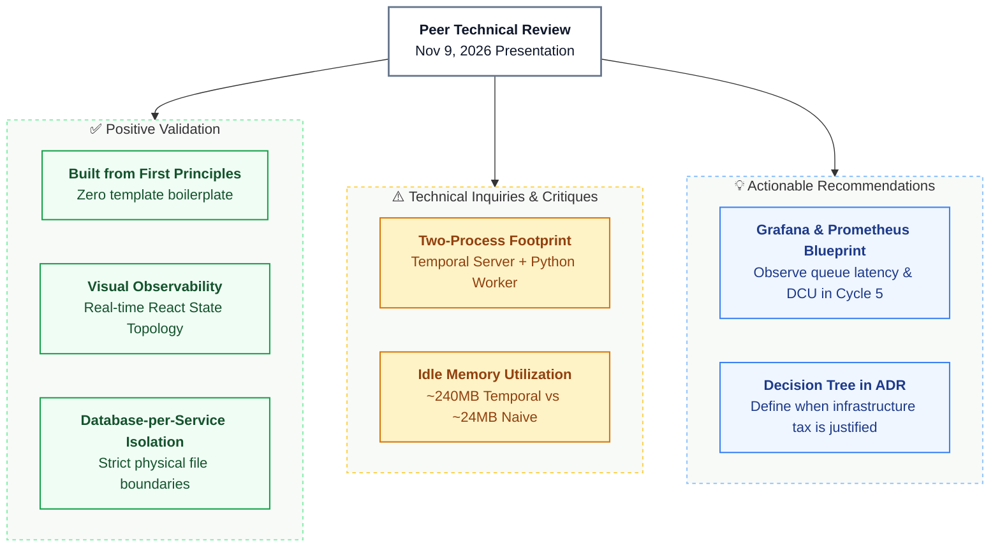
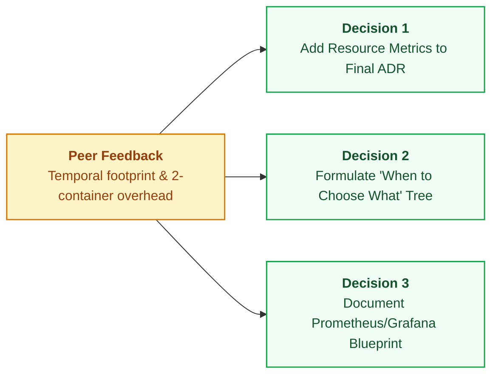

# Peer Knowledge Sharing & Technical Feedback Reflection

## Introduction

> Documented and analyzed feedback from the peer knowledge-sharing session for **Personal Leadership (LO5)**. Evaluated trade-offs raised by peers regarding Temporal's multi-container footprint versus in-memory coordination, steering project scope toward resource benchmarking and metric observability for Cycle 5.

---

## Context and the Problem

In software engineering, technical decisions must be communicated effectively to team members and stakeholders. Validating an architecture requires exposing it to peer scrutiny, actively listening to critiques, and incorporating valid technical feedback into subsequent project iterations.

For the **Knowledge Sharing & Peer Matchmaking Session** (November 9, 2026), I prepared a 3-minute technical pitch video and a live system demonstration for fellow software engineering students specializing in distributed architectures:

* **The Problem:** Distributed failure modes under Database-per-Service isolation (inability of single-database ACID rollbacks to span microservice boundaries).
* **The Research Goal:** Empirical comparison of in-memory procedural LIFO rollbacks (`try/except` in RAM) versus durable, event-sourced orchestration ([Temporal.io](https://temporal.io)).
* **Live Demo:** Demonstrating LIFO rollbacks on `Payment decline` and process crash benchmarking (`SIGKILL` during `Chaos pause 4s`) showing orphaned holds in `flight.db`.

### Peer Review Group Composition

Following the pitch presentations, I formed a peer review group with three students whose projects also focus on modular backend systems and distributed services:

* **Ernestas Bogdan**
* **Vladyslav Luzianin**
* **Martin Simeonov**

---

## Systems Thinking: How Feedback Impacts the Architecture

The peer review session provided both positive validation and constructive critiques regarding system overhead:

### Positive Validation

1. **Built from Scratch:** Peers commended that the entire microservice topology—database schemas, contract models, compensating endpoints, Docker orchestration, and the naive in-memory coordinator—was built from first principles rather than relying on template boilerplates.
2. **Visual Observability:** Peers highlighted the value of the React dashboard in making distributed state transitions visible in real time during failure scenarios.
3. **Modularity & Isolation:** The group validated the decision to enforce true Database-per-Service autonomy (`flight.db`, `hotel.db`, `payment.db`), agreeing that sharing a single database undermines the research into partial failures.

---

## Progressive Engineering Steps

### 1 Feedback Collection & Raw Notes

During the walkthrough and terminal database inspection, raw feedback was recorded in [`docs/feedback.md`](../../../feedback.md):

* Positive feedback on UI clarity and modularity.
* Critical observation: *«Temporal always takes 2 services running (server + worker), whereas the vanilla baseline orchestrator is just a single Python process.»*
* Constructive suggestion: *«Use Grafana for resource monitoring to measure the exact difference in system footprint between the two approaches.»*

### 2 Trade-off Evaluation (The Infrastructure Tax)

The peer observation regarding container count highlights a valid engineering trade-off: **fault tolerance requires additional infrastructure**.

| Evaluation Dimension | Vanilla In-Memory Saga (`layover-naive`) | Durable Orchestration (`temporal` + `worker`) | Engineering Justification |
| :--- | :--- | :--- | :--- |
| **Process Count** | **1 process** (standalone FastAPI container on `:8004`) | **2 processes minimum** (`temporal` server cluster on `:7233` + `layover-worker`) | Temporal decouples state storage from execution logic. |
| **Idle Memory Footprint** | **~24 MB RAM** | **~190 MB – 260 MB RAM** (combined Go server + Python worker runtime) | Temporal maintains caching, internal persistence, and gRPC connection pools. |
| **Idle CPU Utilization** | **~0.0%** (sleeps until HTTP request arrives) | **~0.4% – 1.2%** (continuous Task Queue long-polling by worker) | Workers poll the task queue to detect scheduled activities or workflow signals. |
| **Network Overhead** | Low (direct synchronous HTTP calls between microservices) | Moderate (Worker $\leftrightarrow$ Temporal Server gRPC round-trips for each event) | Every forward step and compensation is committed to the Event History before execution proceeds. |
| **Crash Resilience (SIGKILL)** | **ZERO FAULT TOLERANCE** Rollback stack is destroyed in RAM. Results in **Orphaned Holds** in database. | **100% FAULT TOLERANT** State is persisted in Event History. Worker restart replays log and completes saga cleanly. | Durability guarantees mathematical eventual consistency, eliminating manual data reconciliation. |

---

## Key Decisions & Steering for Cycle 5

Translating feedback into actionable improvements is a core demonstration of engineering ownership. Based on this session, I made three project steering decisions for [Cycle 5](../../../pdp.md#cycle-details):

1. **Incorporate Resource Footprint into the ADR:** Rather than evaluating Temporal purely on crash recovery, the comparison report ([LO4 ADR](../../lo4/adr-orchestrator-selection/lo4-architectural-decision-record.md)) includes empirical memory, CPU, and container complexity metrics alongside data consistency guarantees.
2. **Formulate a Definitive Decision Matrix:** Formulated guidance on when a team should *avoid* Temporal:
   * *Choose In-Memory / Scripting:* When workflows are short-lived (<2s), non-transactional, idempotent, or where a failed run can simply be retried by the client.
   * *Choose Temporal:* When workflows span multiple services, involve financial charges, require durable timers (days/weeks), or cannot tolerate orphaned holds under process crashes.
3. **Plan Resource Monitoring for Extended Cycle 5:** While building a full Grafana stack was outside the initial 38-hour budget, I planned an integration blueprint showing how Temporal's native Prometheus metrics endpoint (`:9090`) can be visualized to monitor latency and queue backlogs.

---

## Reflection & Learning Outcome Justification

### What Went Well

* **Clear Technical Communication:** Explained distributed transaction concepts (Sagas, compensations, 2PC, event sourcing) clearly to peers, using the live dashboard to ground the discussion in concrete behavior.
* **Problem-Solving Under Constraints:** When illness prevented live voice recording, I scripted the presentation and used an AI voiceover tool to deliver the video on time without delaying the group milestone.
* **Constructive Feedback Integration:** Rather than dismissing peer critiques regarding container count, I analyzed the observation and extracted an empirical trade-off analysis that directly strengthens LO4.

### Areas for Improvement

* **Audience Calibration:** In initial discussions, diving straight into Temporal SDK internals (determinism replay, workflow sandbox) was too granular for peers unfamiliar with workflow engines. Starting with the UI workflow visualization proved much more effective.
* **Time Management:** Demonstrating three scenarios and doing database checks took slightly longer than allocated. For future presentations, I will use the dedicated runbook ([`docs/demo-scenarios.md`](../../../demo-scenarios.md)) to keep live demonstrations under 5 minutes.

* **Personal Leadership (LO5):** Proactively prepared and presented technical deliverables under time and health constraints, facilitated structured peer review, evaluated critical architectural observations, and adjusted project scope to incorporate empirical resource benchmarking into the final research cycle.
